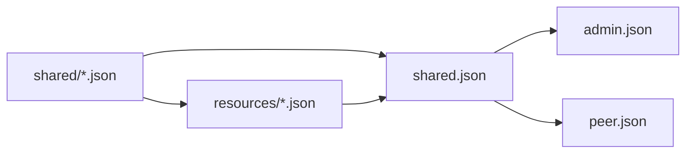

# HTTP Schema dependency rules

Repository-owned HTTP schema is divided into Shared, Resources and two API surfaces by ownership. The OpenAI-compatible wire contract belongs to AI Server Shell and is outside this graph.

## Directory

```text
api/http/
├── admin.json
├── peer.json
├── shared.json
├── shared/
│   └── ...
└── resources/
    └── ...
```

## Depends on direction



Dependencies must remain one-way:

```text
shared/ ← resources/ ← shared.json ← admin
shared.json ← public
```

`shared/` Do not quote `resources/`. `resources/` can quote `shared/`. `shared.json` is the generation entry, and exports two layers of stable schema at the same time; its file name does not indicate that the Resource belongs to Shared ownership.

## Shared Rules

Schema can only be entered `shared/` if at least one of the following conditions is met:

- Used directly by more than two HTTP surfaces;
- Used by two or more domain owners;
- It is a stable value contract shared by multiple Resources.

The need to generate Go or JavaScript symbols does not constitute a reason for Shared. There is only one owner schema and the owner is placed in the same file.

### Shared ownership

Find the existing owner in the [Shared source directory](https://github.com/GizClaw/gizclaw/tree/main/api/http/shared). Add a Shared definition only when no suitable owner exists and multiple independent consumers need it. Domain-specific types remain with their Resource or API surface; language generation alone does not justify sharing.

## Resource rules

Each `resources/<kind>.json` also has:

- The specific kind of Resource envelope;
- This Resource is exclusive to Spec;
- Only serve the nested values of this Resource;
- Explicit reference to Shared schema.

`resources/resource.json` owns `ResourceAPIVersion`, `ResourceKind`, `ResourceMetadata`, Apply contract and Resource union. Resource exclusive Spec does not include `shared/`.

## Surface rules

- `admin.json` refers to Shared values and Resource graph via `shared.json`.
- `peer.json` only quotes `shared.json`, not Admin Resources. Public-only DTO is defined directly at `peer.json`.
- OpenAI-compatible wire models stay in AI Server Shell and do not reference the repository-owned Shared graph.

## File boundaries

File boundaries are determined by common owners and common changes:

- `*Spec` of a single Resource is inlined into the corresponding Resource file.
- The parent, enum and nested value in a field are merged into the same Shared file.
- Split out new Shared files only if independent reuse and stable semantics exist.

Schema file merging must not change JSON properties, required/nullable semantics, enum values, discriminators, or OpenAPI operation IDs.
