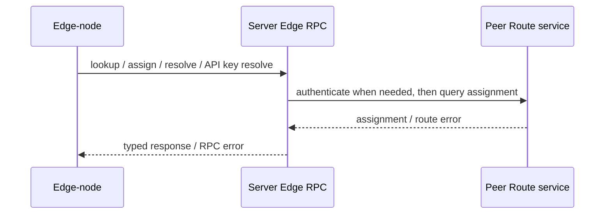

# Server Provided to Edge-node

This set of capabilities is implemented by Server and is only provided to connections with Edge-node role. Edge-node uses it to query Peer assignments and resolve upstream routes, without exposing control plane capabilities to ordinary clients.

The [RPC API Reference](/references/rpc#edge-rpc) is the single list of exact method IDs, names, and purposes. This page only explains the Edge-node role, call flow, and authorization boundary.

## Calling relationship

Server uses independent Edge RPC dispatch for route methods and terminal notification delivery. Even if the ordinary Client RPC surface shares the same `rpc.proto` registry, it cannot obtain the calling permission because the method can be decoded; role authorization and service exposure must limit the Edge control plane at the same time.

`server.api_key.resolve` lets the Edge submit an incoming Bearer credential to
the Server API-key service and obtain the owner Peer's fixed assignment. In a
multi-Server deployment, Servers share the protected API-key Redis Store; the
Edge receives no Redis credential. The RPC returns only the assignment, never
the API-key record, hash, or secret index, and errors and logs must not contain
the request credential. The target Server still performs final authentication
and authorization for the original HTTP request.

## Notification delivery and reverse relay

`server.social.ping.deliver` pushes `client.social.ping` to a local Peer and
requires its ACK to succeed. A missing local target returns NOT_FOUND without
further relay. Each call rechecks the active Edge role.

Edge provides `edge.social.ping.relay` to its configured, identity-verified
upstream Servers. It resolves the target PK's existing Server assignment and
calls deliver on the matching configured upstream. Reverse handlers run only
on outbound Server transports, never device ingress. Both methods use the
source proto's `SocialPingDeliveryRequest` and `SocialPingDeliveryResponse`
and retain one three-second deadline. See [Edge RPC](../../../gizclaw/rpc/edge#cross-server-notifications)
for routing and lifecycle details.
