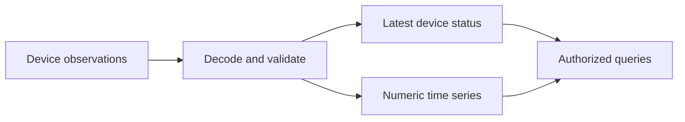

# Telemetry API

Telemetry carries one-way observations from a device to Server, separate from RPC calls and Admin resources. [peer_telemetry.proto](https://github.com/GizClaw/gizclaw/blob/main/api/proto/telemetry/peer_telemetry.proto) owns fields, enums, and units. Decoding, status projection, and persistence live in [peertelemetry](https://github.com/GizClaw/gizclaw/tree/main/pkgs/gizclaw/services/runtime/peertelemetry).

See [Direct packets](/references/streams#direct-packets) for transport semantics.

## Data path

Observations, status snapshots, and metrics serve reporting, current-state display, and time-series analysis. Choose the appropriate entrypoint rather than treating a storage model as a wire message.

## Design rules

Change the Schema before regenerating SDKs and updating senders and consumers. Numeric metrics need explicit units; identities, versions, and free text belong in status displays rather than high-cardinality metric labels.

Observation time determines freshness and differs from packet arrival time. Consult the processing code for validation and merge rules.

## Activity reporting

Activity answers “what is the device doing now?” for status displays. Applications may localize known activity identifiers but should preserve unknown values. Do not infer permissions or metric semantics from an activity string.

## Firmware version reporting

A version identifies a release for display; a digest identifies a specific package. Neither a displayed version nor one observation replaces installation qualification and the device's reported upgrade result.

## Network reporting

Network observations distinguish the active route's signal, connectivity, and cellular identity. Do not invent missing identities or report cached identities from a removed SIM.

IMEI, IMSI, and GNSS are owner-scoped data for authorized status queries, not logs, traces, or metric labels. Telemetry identity reporting and device identity-index maintenance are separate paths.

## OTA reporting

Keep one attempt identity throughout an upgrade and choose a new identity for a retry. Download completion and successful installation are different stages; display success only after device confirmation.

Queries return the latest Server snapshot, which can remain visible after a device disconnects. Telemetry transport provides neither business acknowledgement nor exactly-once delivery, so sending an observation does not prove upgrade completion.

SDKs encode and send the Schema; Server validates and updates snapshots. See the [runtime OTA store](https://github.com/GizClaw/gizclaw/blob/main/pkgs/gizclaw/services/runtime/peerrun/ota.go) for transitions and ordering. Device-provided diagnostics must not contain secrets or credential-bearing URLs.

## Device-reported KV state

KV retains the device's latest reported JSON state across disconnects and restarts. It stays separate
from Server-authoritative online state, ownership and permissions. Readers preserve JSON types and
distinguish present null/false/zero from an absent or deleted key; use the raw JSON encoding when numeric
encoding must be preserved.

Devices should use a bounded, stable key set and re-report current state with actual new observation
times. Tombstones prevent late or replayed values from resurrecting deleted state, and ordinary control
responses cannot overwrite the snapshot. See [KV validation](https://github.com/GizClaw/gizclaw/blob/main/pkgs/gizclaw/api/telemetry/kv.go),
[Telemetry handling](https://github.com/GizClaw/gizclaw/tree/main/pkgs/gizclaw/services/runtime/peertelemetry)
and [KV storage](https://github.com/GizClaw/gizclaw/blob/main/pkgs/gizclaw/services/runtime/peerrun/kv.go)
for wire/storage budgets, timestamp checks and merge rules.

Go, JavaScript and C use the existing Telemetry transport; Flutter reads the status projection. Access
uses existing device-scoped authorization. Values do not enter metrics or payload logs, and devices must
not report passwords or credentials.
