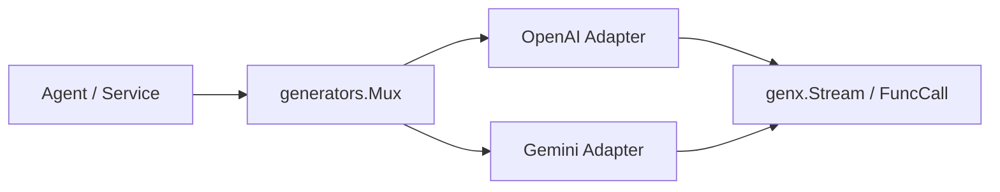

# Generators Overview

[Source](https://github.com/GizClaw/gizclaw/tree/main/pkgs/genx/generators)

`pkgs/genx/generators` manages the registration and selection of `genx.Generator`. The caller uses the pattern to select the Generator, and then executes the generation with the unified `ModelContext -> Stream` contract, without directly binding the specific model protocol.

[Go API References](https://pkg.go.dev/github.com/GizClaw/gizclaw-go/pkgs/genx/generators)

## Structure

| Modules | Responsibilities |
| --- | --- |
| [OpenAI Adapter](./openai) | Convert OpenAI-compatible Chat Completions to GenX message, stream, tool call and usage. |
| [Gemini Adapter](./gemini) | Convert Gemini GenerateContent to the same GenX contract. |

Generators only manage generating protocols and routes. Model configuration, credentials, tenants, and product catalog do not belong to this package.
