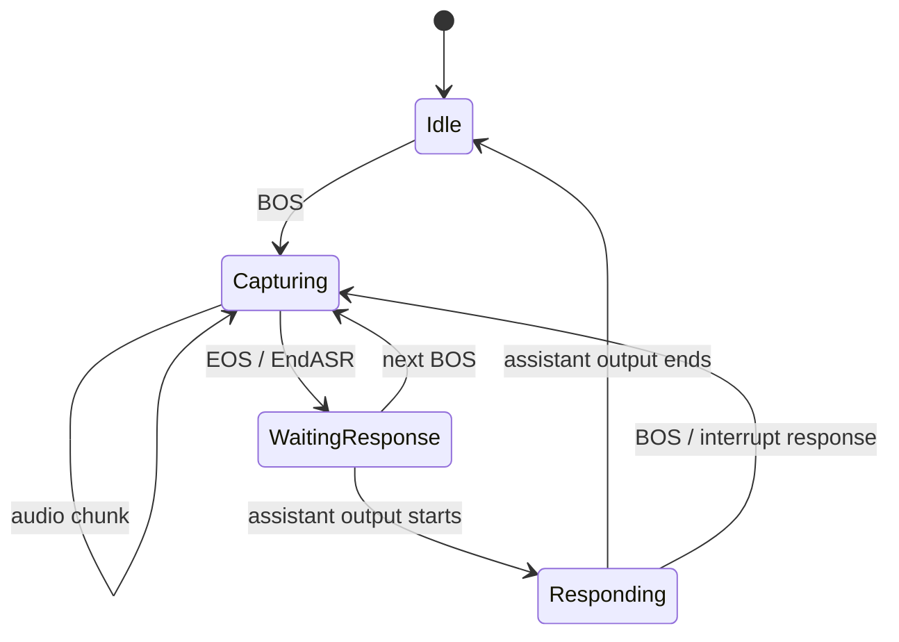

# Doubao Speech Adapter

Doubao Speech Adapter adapts Doubao speech protocol to `genx.Transformer`, covering one-way recognition, speech generation, real-time dialogue, duplex real-time dialogue and voice translation.

Each adapter uses a package-owned typed constructor:

```go
doubaoasr.New(doubaoasr.Config{Client: client})
doubaotts.NewSeedV2(doubaotts.SeedV2Config{Client: client, Speaker: speaker})
doubaotts.NewICLV2(doubaotts.ICLV2Config{Client: client, Speaker: speaker})
doubaoast.New(doubaoast.Config{Client: client})
doubaorealtime.New(doubaorealtime.Config{Client: client, Model: realtimeModel})
doubaorealtimeduplex.New(doubaorealtimeduplex.Config{Client: client, Model: duplexModel})
```

Constructors do not open provider sessions; each concurrent `Transform` call owns its session and runtime state. Realtime Dialogue and Realtime Duplex require an explicit `Model` and reject an empty or whitespace-only value instead of using an SDK default. ASR, TTS, AST, and Realtime Dialogue do not accept Toolkit configuration. Realtime Duplex is agent-capable because its provider protocol supports function-call output continuation.

## Abilities

| Transformer | Input and Output |
| --- | --- |
| `doubaoasr.Transformer` | Audio Stream → transcription Stream. |
| `doubaotts.SeedV2` | Text Stream → generated audio Stream. |
| `doubaotts.ICLV2` | Text Stream → ICL voice audio Stream. |
| `doubaorealtime.Transformer` | Adapts the Doubao Realtime Dialogue API (`volc.speech.dialog`), explicitly handles ASR, Chat, and TTS events, and supports Push-to-Talk, continuous voice, and text input. |
| `doubaorealtimeduplex.Transformer` | Adapts the independent Realtime Duplex API, which handles continuous duplex audio and its transcription, response text/audio, function call, and response cancellation events. |
| `doubaoast.Transformer` | Speech input → translated text/audio Stream. |

Each Transformer's typed Config defines stable configuration, while the context passed to `Transform` controls one request's lifecycle. The Adapter must internally convert provider events, audio formats, usage, terminal states, and errors to GenX Stream.

Every output route or MIME channel created by a Doubao Transformer has an explicit lifecycle owned by that Transformer. ASR transcripts and history audio, TTS audio, AST transcript/translation/history/audio, and Realtime transcript/assistant text/audio each emit BOS before or with their first data and one matching EOS, including empty and error completions. Input or unrelated routes that the Transformer does not create remain pass-through boundaries and are not repaired or closed on another component's behalf.

When a replacement BOS interrupts a push-to-talk ASR session, the adapter closes that input's open History audio channel and emits an `interrupted` transcript EOS with the old StreamID before recognizing the next input. Recognized text retains its original input identity, and later History reads can finish waiting for that transcript. Realtime retains its segment-level interruption terminals.

With `EmitInterim=true`, an unchanged text-only snapshot of committed speech does not open another interim transcript or interrupt the active reply. Explicit interim utterances and identical words with different definite-utterance timestamps are still delivered.

### ASR empty recognition

When a Doubao ASR provider session completes normally without non-whitespace final result text or definite utterance text, `doubaoasr.Transformer` completes that recognition successfully without emitting recognized transcript text. A zero-content terminal chunk required by the existing Stream route remains a successful internal boundary rather than recognized user text.

After an explicit audio EOS, `doubaoasr.Transformer` waits at most one minute for provider finalization. If the provider remains silent, the transformer closes that provider session and terminates the output stream with a `doubao asr: finalization timeout` error instead of inheriting the caller's longer lifecycle deadline.

A completed final audio send retains its result when provider finalization closes the session concurrently. Normal recognition therefore still emits its transcript EOS; actual provider send errors and sends started after session completion retain their errors.

An interim transcript route that never receives a definite result remains an error. A replacement's `interrupted` EOS ends its prior route and recognition continues on the next input without recovery retry. Other provider, protocol, caller cancellation, malformed-audio, unsupported-format failures, and timeouts outside the recovery boundary below retain their normal error propagation.

For PCM input, ASR aggregates small live frames within the current provider session until they reach the configured packet size. The default is 100 ms (`3200` bytes for 16 kHz mono signed 16-bit PCM). Full packets are sent immediately in order, and an explicit audio EOS sends any remaining PCM exactly once as the final packet; an exact packet boundary uses the existing empty terminal marker without duplicating audio. Compressed input retains its original packet boundaries and final-packet behavior. Session cleanup discards only that session's empty buffer, so no audio crosses route or replacement-session boundaries. The outer Transformer stream remains open after an explicit route EOS, and the next audio route creates a replacement session with an independent transcript. A provider packet-wait timeout while finalizing continuous ASR is the expected recoverable post-route boundary. Provider errors outside the recovery boundary and the one-minute local finalization timeout terminate the outer stream.

### ASR recovery

`doubaoasr.Transformer` retries upstream code `55000000`, including a BigASR business RPC timeout, once at a safe current-input boundary: at most two attempts. It replaces only the ASR provider session, without rerunning the Workflow, Eino Graph, Memory, or Tools. Recovery does not depend on the final `STREAM_ERROR` retryability projection.

Recovery supports PCM provider sessions, including audio converted to PCM by the adapter. PTT retains current audio until definite text becomes visible. Continuous ASR advances its replay checkpoint at valid newly committed definite-utterance end times, retaining only subsequent audio. Repeated committed utterances in cumulative frames neither change the checkpoint nor disable the current window. Replacement timestamps map back to the original audio timeline, preserving transcript routes and History audio ranges. Interim hypotheses remain replaceable and do not submit another definite Agent turn.

An input observer reads ahead at most 4096 chunks and 2 MiB of Blob data so a replacement BOS can cancel a blocked recovery upload. Overflow terminates with an explicit input queue limit error. Only recovering input is preempted early; queued old suffixes cannot reopen retired sessions. The uncommitted replay window is capped at 15 seconds and 2 MiB. Exceeding either cap disables recovery for that session while recognition continues; replay snapshots have the same cap. A logical session retains at most 1024 hashes of committed utterance identities, without retaining their text; exceeding that budget disables recovery for that session. Reconnection, replay upload, and waiting for a definite/final result share a 15-second deadline. Success and deadline removal require both upload and recognition to complete. Only a newly committed continuous utterance resets the next turn's retry allowance.

Partial committed PTT text, missing/invalid timestamps, non-PCM sessions, overflow, second failures, authentication, quota, protocol/input errors, and local finalization timeout are not replayed. Empty recognition and continuous packet-wait boundaries retain existing behavior. Invocation cancellation covers stop, Workspace/input-mode changes, resource deletion, disconnect, and output closure. Replacing an input route cancels and joins the old provider reader/sender before creating the replacement; late generations cannot publish into it. Exhausted recovery retains the diagnostic error terminal instead of making every `STREAM_ERROR` retryable.

WARN records appear in order: `doubao asr: attempt failed`, `doubao asr: retry start`, then `doubao asr: retry success` or `doubao asr: retry failure`. Recovery success deliberately remains WARN so production WARN thresholds retain the complete exceptional recovery. Ordinary success adds no operational record. Fields include `retry=0/1`, GizClaw's logical-session `asr_request_id`, input/transcript stream IDs, `segment_index`, elapsed/retry milliseconds, reason and error. The production context logger supplies Peer, connection `session_id`, `workspace`, and any existing ingress `request_id`; long-lived runtime audio does not invent an ingress ID.

Provider errors preserve `error_code`, `upstream_reqid`, `upstream_connect_id`, `upstream_trace_id`, and `upstream_log_id`. Missing IDs stay empty and remain distinct from GizClaw IDs. Successful recovery records replacement-result metadata when available. Local timeout/incomplete completion retains the attempt's last available metadata; missing fields on structured errors use separate `upstream_last_*` fields without overwriting the original error. Interim-only completion is a retry failure, and local diagnostics contain counts/state rather than recognized text. Retry logs omit recordings, transcript content, credentials, and history. Billed audio across attempts is accumulated in existing ASR usage.

### ASR endpointing parameters

`doubaoasr.Config` passes BigASR VAD request parameters to each SAUC session through `VADSegmentDuration`, `EndWindowSize`, and `ForceToSpeechTime`. These fields use `*int`: `nil` omits the field and preserves provider-default behavior, while non-nil sends the value, including an explicit zero.

GizClaw's Volc ASR Builder accepts `vad_segment_duration`, `end_window_size`, and `force_to_speech_time`, together with their camelCase aliases. When the caller provides no endpointing parameter, the Builder uses `end_window_size=500` and `force_to_speech_time=1000`: measured with `TestEinoRealtimeFirstResponseBreakdown`, an 800 ms silence window often pushed realtime speech-end-to-first-text past the 2 s first-response gate, while 500 ms keeps it near 1 s with unchanged transcripts; `force_to_speech_time` has a documented minimum of `1`, so `0` is not a valid "no minimum" value. When the caller provides any endpointing parameter, the Builder sends only the explicitly provided fields.

When external ASR returns an empty final text, Doubao Realtime completes that PTT input locally without calling `SendText` or `EndASR`, allowing the next recording to start. An empty text MIME boundary within a turn that has uploaded audio does not commit that audio early.

### Seed V2 segment failures

The [shared TTS pipeline](./stream-processing#tts-stream-processing) manages candidate boundaries, collection budgets, and request lengths. `genx.WithTTSBatching` configures one invocation. Several candidate segments can share one provider request, and `SegmentIndex` counts submitted synthesis requests.

`doubaotts.SeedV2` requests each submitted readable batch once, without retrying, switching voices, or synthesizing replacement content. A provider failure, including truncation or completion without normalized audio, ends that batch and lets later batches continue in order. Already emitted audio is retained without replay or rollback.

Each segment failure logs one ERROR `doubao tts: segment failed` with `stream_id`, one-based `segment_index`, and `error`. Structured SDK errors additionally provide `code`, `message`, `request_id`, `trace_id`, and `log_id`. The operational log does not copy synthesis text, audio, or credentials.

If the route emitted any audio, including a failed segment's partial audio, it completes with successful audio EOS after all segments are processed. If every segment fails and no audio is emitted, the route returns its first provider cause after attempting all segments. Empty successful provider output uses `doubaotts: seed v2 completed without audio`. Audio Dock and Peer preserve delivered reply text and propagate the existing error EOS boundaries for a wholly empty failure.

The SDK's default HTTP TTS stream has no whole-request timeout. The caller context controls both waiting for headers and reading audio, with no fallback or inactivity timer. Explicit `WithTimeout` or a custom HTTP client still honors the caller's timeout choice; GizClaw's default builder supplies neither. Non-streaming SDK HTTP defaults are unchanged.

Caller cancellation/deadline, input errors, and downstream emission failures remain terminal. `ctx.Err()` determines whether the remaining segments are canceled: with a live caller context, a provider/client-local error wrapping `context.DeadlineExceeded` or `context.Canceled` is logged as a continuable provider segment failure. Other TTS adapters retain their own failure policies.

## AST Translate input modes

AST v2 has `s2t` (translated text) and `s2s` (translated text and provider audio) output modes, with no PTT/realtime request parameter. `doubaoast.Transformer` always uploads audio and receives events concurrently, forwarding normalized transcripts, translations, history audio and synthesized audio as they arrive. Translations returned before input completion can enter external TTS immediately.

Provider source subtitles delimit transcript and recording segments. Each translation subtitle has paired text BOS/EOS and sends `MessageEnd` at finalization so synthesis flushes confirmed text even without sentence punctuation. Multiple translations within one source subtitle each reopen their text lifecycle; fresh final-only subtitles preserve repeated content, while extending cumulative finals emit only their new suffix and its separator whitespace even without interim tokens. Audio Dock composes external Voices using the existing TTS segmentation. The AST output queue adds no fixed delay to text chunks.

PTT publication belongs to [AgentHost runtime](/en/developing/gizclaw/services/runtime/agenthost). Runtime resolves intent from an admitted input BOS and the Workspace default, then buffers the turn before History and playback. Admission of the release EOS publishes prepared output without waiting for the adapter uploader to read EOS, upstream `Finish`, or all results. Realtime output passes through continuously. Direct GenX Transformer calls do not include this product policy.

On audio EOS, the adapter sends 500 ms of provider-only silence before `Finish`, without realtime pacing or history recording. This preserves the last sentence outside zh/en when speech ends without a pause. Successful sessions with no translation still close an empty assistant text route and, for `s2s`, an empty audio route. Session completion is bounded to 45 seconds after `Finish`.

Provider transcript and translation tokens carry subword spacing, such as `"Bon"`, `"jour"`, and `" à"`. Tokens within one subtitle are joined verbatim, removing only leading whitespace at the start of text. A new subtitle in the same output segment gets one separating space when it and the previous sentence meet at ASCII letters or digits.

Receive errors end output immediately with the original cause, without waiting for more input or audio EOS. A receive stream ending before `SessionFinished`, including a normal WebSocket close, returns an incomplete-session error wrapping `io.ErrUnexpectedEOF`. Cancelling the context or closing output closes the provider session, receiver and input reader. Every session output and interruption terminal retains its immutable input epoch, so late output cannot acquire a newer capture's ownership.

## Two sets of Realtime API

| Boundary | Realtime Dialogue | Realtime Duplex |
| --- | --- | --- |
| Go Adapter | `doubaorealtime.Transformer` | `doubaorealtimeduplex.Transformer` |
| Provider session | `Client.Realtime.Connect` | `Client.RealtimeDuplex.OpenSession` |
| Input method | Push-to-Talk, continuous realtime, text | Continuous full-duplex audio |
| Provider events | ASR, Chat, TTS, Session | Transcription, Response text/audio, Function call, Session |
| Interrupt operation | `Interrupt` | `CancelResponse` |
| Tool result | Not provided by this session contract | `SendFunctionCallOutputs` |

The two Adapters can share GenX Stream, audio conversion, StreamID, and lifecycle infrastructure, but cannot merge provider session interface or event mapping. Push-to-Talk belongs only to the Realtime Dialogue API and should not be emulated by the Realtime Duplex Adapter.

### Realtime Duplex stream identity and input boundaries

Realtime Duplex relies on provider server VAD to segment continuous utterances. A control-route BOS and an audio MIME BOS with the same StreamID open the local input segment. Audio MIME EOS and control-route EOS close only their corresponding local codec/segment boundaries and do not send `input_audio_buffer.commit`. When a BOS or EOS chunk also carries audio data, the Adapter sends that payload before applying the boundary transition. Non-audio MIME boundaries cannot close the audio segment early.

After a provider session event stream completes, a successful empty audio/control EOS only closes the completed local input; it does not open another session. A new BOS, data-bearing audio EOS and input errors remain available to subsequent processing.

Provider `ResponseID` and `QuestionID` values are protocol metadata and may differ between events for one logical response, so they are not GenX route identity. The Adapter creates one stable owned StreamID for the current response; assistant text and audio MIME channels share that StreamID and each emit a complete BOS/data/EOS lifecycle. A provider transcription delta may be either a token or a cumulative hypothesis; the Adapter publishes only the suffix not already emitted and does not duplicate semantic content for repeated hypotheses.

## Realtime Duplex function-tool continuation

```go
transformer, err := doubaorealtimeduplex.New(doubaorealtimeduplex.Config{
    Client:       client,
    Model:        duplexModel,
    ToolInvoker: runtimeTools,
    MaxToolCalls: 32,
})
```

When `ToolInvoker` is non-nil, every `Transform` resolves the current function names, descriptions, and JSON Schemas before opening its provider session. Realtime Duplex function calls execute in provider order through `InvokeTool(name, arguments)`. Each raw JSON result is sent immediately with the original provider call ID so the provider can continue the conversation. ToolCall and ToolResult control data remain internal and never enter the public GenX Stream.

The Transformer owns provider call IDs, ordering, duplicate-ID rejection, and the per-invocation `MaxToolCalls` budget. Zero uses 32 and negative values are rejected. Independent concurrent `Transform` calls have separate call-ID sets and budgets, even when they share one invoker. A nil invoker advertises no tools; a provider function call in that state is a transform error.

Resolution, invocation, invalid result JSON, result submission, cancellation, duplicate-ID, and budget errors terminate only the affected Transform. The injected invoker owns runtime resource lookup, authorization, argument validation, and executor dispatch. Realtime Dialogue remains unchanged because its session contract has no function-result continuation operation.

## Realtime Dialogue input mode

`doubaorealtime.Transformer` supports three input modes:

| Mode | Input Boundaries |
| --- | --- |
| Push-to-Talk | BOS starts a push-to-talk, the audio chunks belong to the current turn, EOS ends the input and triggers `EndASR`. |
| Realtime | Continuously sends audio, and the user utterance is divided by provider VAD; entering EOS only closes the local segment. |
| Text | Combines text fragments sharing a StreamID and submits at EOS; does not accept audio input. |

Text mode accumulates fragments with a `StreamID` as one user message and calls provider `SendText` once at EOS. The accumulated limit is 1 MiB; exceeding it terminates the Transform. A new input ID replaces unsubmitted text, duplicate EOS does not submit twice, and input EOF discards fragments without EOS. An EOS carrying an error discards buffered text and returns failure without submitting a provider message. A text chunk without a `StreamID` is submitted directly as one complete message.

`Config.Model` is required and is never inferred by the transformer. `Config.Instructions` is the semantic initial dialogue instruction. GizClaw passes it unchanged to `doubao-speech-go`; the SDK maps it to `dialog.system_role` for O20 or `dialog.character_manifest` for SC20 after model normalization. Exact `SystemRole`, `SpeakingStyle`, and `CharacterManifest` settings remain independent advanced fields and are validated by the SDK. The adapter does not copy semantic instructions into `prompt.system`, and it does not inject an O-only `BotName` into SC20 sessions.

One provider response owns one spoken-text route and one audio route. Non-empty sentence text from TTS-start event `350` is canonical and is emitted once per synthesized sentence; Chat event `550` text is buffered and used only when the response finishes without any TTS sentence text. Non-empty text from TTS segment-end event `351` is buffered in arrival order and is emitted only after Chat and TTS have both finished and neither `350` nor `550` supplied non-empty text. It is never duplicated alongside a preferred source. The first TTS start or audio payload emits one audio BOS, later sentence starts reuse it, TTS finish emits one audio EOS, and the selected text source emits one text EOS. If all three sources are empty, the empty text route still closes. Failures and interruptions discard buffered, unspoken text rather than publishing it as a successful response.

The transformer owns the long-lived lifecycle. It starts connecting when `Transform` starts and reuses one healthy Realtime Dialogue session across ordinary input turns and BOS/EOS boundaries. A Realtime-mode BOS that interrupts an active response closes that provider session locally and immediately opens a replacement with the same configured instructions, model, and `DialogID`; it does not send the Push-to-Talk-only `ClientInterrupt` event. Unread audio for the new route is consumed only by the replacement. When `ASREnded` binds a Realtime response, that response epoch receives an absolute one-minute completion deadline. Partial ASR does not start it, and later Chat or TTS progress does not extend it. Matching route completion or interruption releases the deadline; expiry gives open transcript or assistant routes an error EOS, closes the stalled session, and begins reconnecting. A stale epoch cannot cancel or expire its replacement. A provider terminal event, transport error, or session I/O error follows the same replacement path with capped exponential backoff. Attempts continue until the transform context or output stream ends.

Push-to-Talk classifies a turn from its accumulated, trimmed ASR hypothesis when the matching `ASREnded` arrives. An empty hypothesis is a successful no-input turn: the transformer publishes the empty transcript lifecycle, then complete empty assistant text and audio lifecycles for that turn, and immediately returns the state machine to Idle. The provider does not accept another Push-to-Talk ASR turn on that session after an empty `ASREnded`, so the transformer closes it and immediately opens a replacement while preserving the caller's Transformer stream and unread input. This deterministic handoff does not arm a response deadline, report provider loss, send `ClientInterrupt`, or apply reconnect backoff. A non-empty hypothesis continues through the existing Push-to-Talk Chat/TTS response path; Push-to-Talk does not use the Realtime response deadline.

Input already handed to a failed session is not replayed. Unread input remains behind the bounded stream backpressure and is consumed by the replacement session. In Push-to-Talk mode, provider loss invalidates the active turn: retained transcript and assistant output are discarded, the remaining chunks are consumed locally through that turn's audio EOS, and the next BOS starts a fresh turn.

Realtime mode treats ordinary BOS, MIME EOS, and route EOS as local stream boundaries. They do not call `EndASR`, inject silence, commit audio, or send `ClientInterrupt`. A new client input route that interrupts an existing reply still closes and replaces the provider session. Input EOF remains terminal: it stops reconnecting and drains the matching Chat/TTS response for a submitted finite Push-to-Talk or Text turn before closing the session. It closes immediately when no response is pending. Text mode sends neither `EndASR` nor `ClientInterrupt`; Push-to-Talk uses those provider operations.

When provider VAD identifies a new `question_id` within the same input route and response identities are available, Realtime keeps the provider connection and closes the interrupted assistant text/audio routes. Already accepted and subsequent audio can finish recognition and receive a complete reply. Late text and terminals from the old question, and anonymous audio belonging to its TTS-start event, cannot enter the new reply. Duplicate `ASRInfo` for the current question does not interrupt again; retired-question history is bounded to 64 entries. A new client route or text-query submission clears VAD state; device text and external-ASR text submissions keep their existing paths. Legacy events without correlatable identities retain the close-and-replace handoff. Identity fields follow the [Volc Realtime API](https://docs.volcengine.com/docs/DoubaoVoice/End-to-endreal-timespeechlargemodelAPIaccessdocument?lang=zh).

PTT binary audio frames carry no question/reply ID, so the latest TTS-start event determines their response owner. When the next input starts, unfinished Chat/TTS records from the previous turn remain available to match late identified events, but cannot consume the new response's anonymous audio. Old terminal events close only their own route.

When a provider response to semantic ASR input, non-empty text input, or an initiative opening finishes without any assistant text or normalized audio, the Transformer reports `doubao realtime response completed without assistant content` on its final assistant EOS. Callers can end the failed turn immediately. The Transformer and provider session remain usable for later turns, without fabricating content or replaying input. Truly empty Push-to-Talk ASR retains its successful empty lifecycle and existing provider-session handoff.

### Realtime Dialogue agent initiative

When the Workspace `conversation.initiative` is `agent`, `doubaorealtime.Transformer` lets the dialogue model generate the opening itself. As soon as the first provider session is open, the transformer submits one hidden query through ChatTextQuery (event 501, SDK `SendText`). The default text asks the model to greet the Peer and open a topic; the Workflow `doubao_realtime.initiative_query` overrides it. The hidden query never enters the output stream or Workspace History; only the model's reply is published as assistant text and audio routes. That route uses the fixed StreamID `initiative` (with the segment suffix in Realtime mode) and never aliases a Peer input route. `Config.Initiative` supports only `on_reload`: at most one query per `Transform` session, so every Workspace served by the same configured transformer opens its own conversation, and every reload produces a new Agent generation that opens again. The factory maps `once_when_empty` to `on_reload` while the Workspace History is empty and leaves initiative disabled otherwise. SayHello and ChatTTSText are not used.

The opening reply follows the non-Push-to-Talk event path. In Push-to-Talk mode it belongs to no turn, bypasses `pttResponses` matching and the turn state machine, and its Chat/TTS events map straight onto the `initiative` route, exactly as in Realtime mode; Text mode waits for it as an ordinary text response. Non-Text modes arm the response deadline for it. A Peer BOS during the opening (a Push-to-Talk barge-in or a new Realtime route) is an ordinary interruption: the `initiative` route receives an `interrupted` EOS, Push-to-Talk sends `ClientInterrupt`, and Realtime performs the local close-and-replace handoff. An interrupted or already started opening is never resent on the replacement session. Only a provider loss before the reply starts, including a failed `SendText`, makes the replacement session submit the hidden query again.

### Realtime Dialogue text output

`Config.Output` selects the reply modality. The default `audio` returns reply text together with provider TTS audio. `text` (pattern parameter `output=text`) sends `dialog.extra.output_modalities: ["text"]` in StartSession; the provider then synthesizes no audio and sends no TTSSentenceStart, TTSSentenceEnd, TTSResponse, or TTSEnded events. The field is absent from the upstream public document and is verified by the `doubao-speech-go` live E2E test. The provider still requires `tts.speaker`, so the session keeps sending the speaker.

With text output each response owns only one assistant text route. ChatResponse (event 550) text is published as it arrives, and ChatEnded (event 559) closes the text route and completes the response without waiting for TTS. Push-to-Talk turns, Text-mode draining, the Realtime response deadline, and the assistant lifecycle all complete at ChatEnded; a response without reply text (including an empty Push-to-Talk turn) still publishes an empty audio lifecycle so clients keep seeing both text and audio EOS, while interruptions close only the text route. The transformer ignores any TTS events or audio the provider still sends.

When a Workflow sets `doubao_realtime.tts.voice`, the factory appends `output=text` to the pattern, checks on reload that the RuntimeProfile Voice resolves, and uses `audiodock` to stream each assistant reply into `voice/<alias>`; user audio still goes straight to the realtime model. `audio.output.voice` stays required to satisfy the provider speaker requirement.

### doubaorealtime Push-to-Talk state machine

This section only describes `doubaorealtime.Transformer`'s adaptation to the Realtime Dialogue API's native Push-to-Talk mode. `doubaorealtimeduplex.Transformer` does not support Push-to-Talk and does not use this state machine.



`doubaorealtime.Transformer`'s Push-to-Talk adaptation must explicitly track the current turn: the Idle state cannot receive audio or EOS; each turn in Capturing can only accept EOS once; after EOS, it cannot continue to send audio to the same turn. When the new BOS arrives, if the previous assistant is still outputting, `Interrupt` of the Realtime Dialogue session should be called, and then the input boundary for the new turn should be established.

Push-to-Talk retains the latest ASR hypothesis and all assistant output until both input audio EOS and provider `ASREnded` have occurred. It then publishes one final transcript plus transcript EOS before releasing assistant chunks in provider order. If the accumulated hypothesis contains no semantic text, it instead closes empty assistant text and audio routes successfully and completes the turn without waiting for provider response events. Retained assistant Opus for semantic turns is limited to two minutes of normalized packet duration; exceeding the limit discards the uncommitted turn, emits one assistant error EOS, and keeps the transformer available for later turns.

All `OpenSession`, `SendAudio`, `SendText`, `EndASR`, interrupt/cancel and function-call output operations must use the context received by `Transform`. Cancel Transform must be able to terminate provider I/O, event receiver and input reader, and cannot start `context.Background()` requests that are out of the calling life cycle.

## Public Realtime Pipeline

Realtime and Realtime Duplex can use different provider event adapters, but should share the following basic components:

- audio MIME normalization, PCM/MP3/Opus decode, Opus encode/transcode and frame preparation;
- per-stream audio input lifecycle;
- StreamID, segment and response ID management;
- assistant interruption epoch, BOS/EOS and growable output buffering;
- pending input, session restart, context cancellation and error shutdown.

Provider-specific event enum, session method and config conversion remain in their respective Adapters. Public media and stream lifecycle cannot be copied into two sets of realtime/duplex implementations.

## Change and regression constraints

Doubao Transformers handle provider session, concurrent event receiver, audio codec, StreamID and BOS/EOS at the same time. Any modification must first fix the behavior contract and then change the implementation.

### Bug fix process

1. First add a regression test that can stabilize failure at the minimum level to prove the input, status and error results of the bug.
2. If the problem exists in both Realtime and Duplex, first add the same test case to the public contract test; you cannot only repair one copy of the implementation.
3. Only modify the layer with this responsibility: provider event mapping, public media pipeline or GenX Stream lifecycle, and cannot be easily rewritten across layers.
4. Keep the mapping of provider event, GenX chunk, StreamID, role, label, BOS/EOS and error compatible; expected changes must update the contract document in the same change.
5. After fixing, run target tests, full package tests, and race tests, and do a new code review.

### Must-test behavior matrix

| Dimensions | Required boundaries |
| --- | --- |
| Input format | PCM, MP3, raw Opus; supported sample rates and channels; illegal MIME and corrupt frames. |
| Stream contract | BOS, data, EOS; duplicate/out-of-order marker; StreamID, role, label and terminal error. |
| Lifecycle | normal close, context cancel, provider EOF/error, blocked Send/Recv, session restart and repeated Close. |
| Realtime Dialogue | Push-to-Talk legal state transitions, single EndASR per turn, Realtime VAD, text mode, Interrupt, the agent-initiative hidden query, and text output completing at ChatEnded. |
| Realtime Duplex | continuous input, transcription, text/audio response, function call output and CancelResponse. |
| Barge-in | pending response, text is being output, audio is being output; only one interrupted EOS is generated, and old epochs must not continue to be output. |
| Output buffering | Provider audio drains immediately into a growable buffer; a slow consumer must not backpressure the provider session. |

Realtime and Duplex's public media and Stream lifecycle must use the same set of table-driven contract tests. Provider-specific fake session only supplements the differences of respective events/session and cannot replicate the entire set of common tests.

### Required verification

```sh
go test ./pkgs/genx/transformers -count=1
go test -race ./pkgs/genx/transformers -count=1
go test ./pkgs/genx/... -count=1
```

Credential-protected integration tests must also be run when real provider contracts, SDK upgrades, or event schema changes are involved; unit test fakes cannot replace the real session's cancel, Close/Recv concurrency, and event ordering verification.
