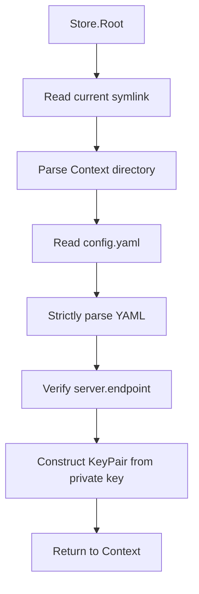

# Context Store

[Source](https://github.com/GizClaw/gizclaw/tree/main/pkgs/gizclaw/contextstore)

`pkgs/gizclaw/contextstore` Manages the local connection Context of the GizClaw client. Each Context is bound to a local Giznet identity and a target Server endpoint; the CLI or other client first selects the Context and then uses its configuration to establish a connection.

[Go API References](https://pkg.go.dev/github.com/GizClaw/gizclaw-go/pkgs/gizclaw/contextstore)

## Disk structure

```text
<context-root>/
├── current -> local
├── local/
│   └── config.yaml
└── staging/
    └── config.yaml
```

- Each first-level subdirectory is a named Context.
- `current` is a symbolic link pointing to the current Context directory name.
- The permissions of the new Context directory are `0700`, and the permissions of `config.yaml` are `0600`.
- When deleting the current Context, `current` will also be removed, and a replacement Context will not be automatically selected.

## config.yaml

```yaml
description: Local development server
identity:
  private-key: <giznet-private-key>
server:
  endpoint: 127.0.0.1:8080
```

`private-key` is a local identity credential and cannot be submitted to the repository, documentation examples, or logs. `Store.Create` will generate a new Giznet key pair and only write the private key to the Context configuration.

## Config structure

A Context keeps local identity and the target Server endpoint together. Fields and validation live in
[context.go](https://github.com/GizClaw/gizclaw/blob/main/pkgs/gizclaw/contextstore/context.go);
[store.go](https://github.com/GizClaw/gizclaw/blob/main/pkgs/gizclaw/contextstore/store.go) owns selection and disk operations.

## Loading process



`LoadSummary` Use the same configuration and private-key verification, but only return the name, description, endpoint, current status and local public key required by the list UI.

## Ownership Boundary

Context Store is not responsible for Server config, Peer registration, WebRTC signaling, HTTP/RPC client, workspace content or other server resources. After the caller obtains the identity and endpoint from the Context Store, the GizClaw connection is established by the connection layer.
