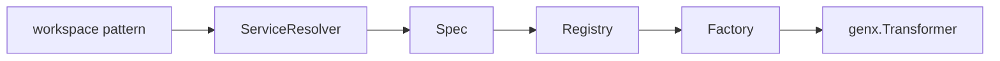

# Agent

[Source](https://github.com/GizClaw/gizclaw/tree/main/pkgs/gizclaw/services/runtime/agent)

[Go API Reference](https://pkg.go.dev/github.com/GizClaw/gizclaw-go/pkgs/gizclaw/services/runtime/agent)

`agent` Parse the workspace pattern into a runnable workflow Transformer. It has the workflow factory registry and resolution from persistent Workspace/Workflow to run specifications, but does not have the long-term online state of the Agent instance.

## Calling relationship

`agent` is not responsible for peer connection, audio output, ToolKit licensing or workspace lease; these online lifecycles are combined by `agenthost`.
