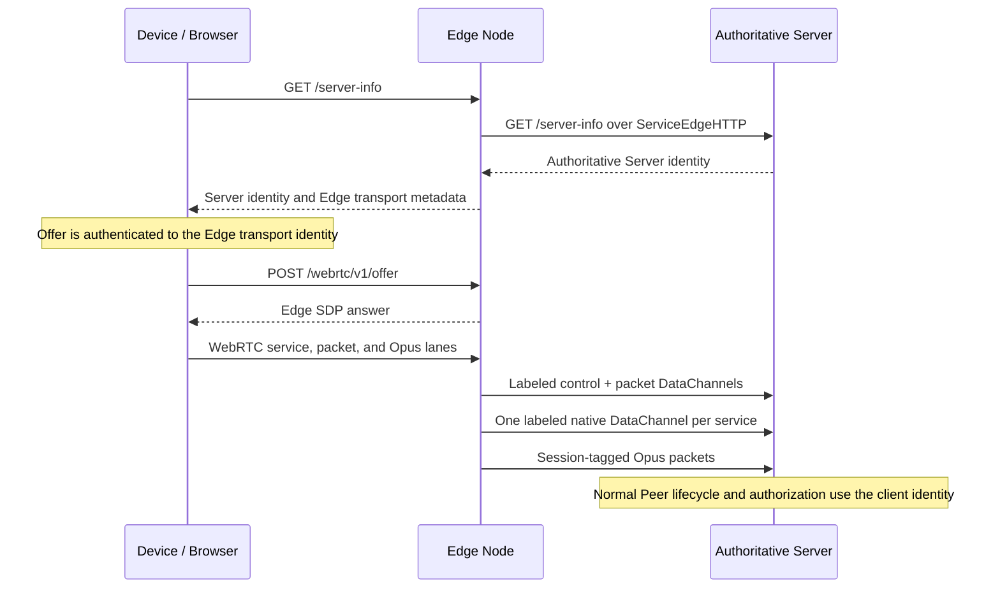
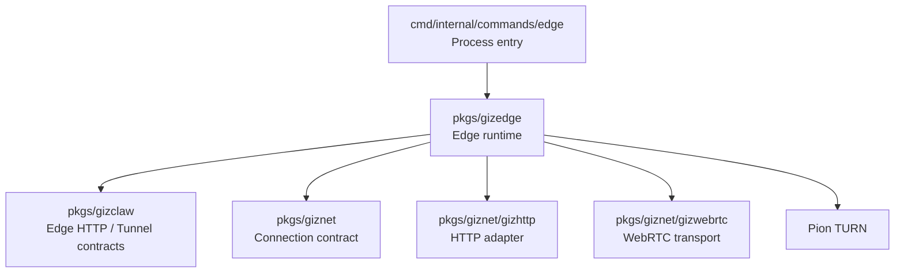

# pkgs/gizedge

`pkgs/gizedge` provides the GizClaw Edge Node ingress runtime. It accepts
public browser and device HTTP requests and forwards them to the configured
authoritative GizClaw Server over a `giznet` WebRTC connection.

When gateway mode is enabled, the Edge also terminates client WebRTC transport
and proxies logical connections over a bounded Server upstream pool. The Edge
is still not the owner of business data: client identity, final authorization,
domain services, and resource storage remain on the authoritative Server.

[Go API References](https://pkg.go.dev/github.com/GizClaw/gizclaw-go/pkgs/gizedge)

## Directory structure

```text
pkgs/gizedge/
├── config.go     # Edge workspace configuration and boundary validation
├── edge.go       # public ingress, upstream connections, and request forwarding
├── gateway.go    # client termination, logical connections, and bounded upstream pool
├── upstream_relay.go # shared upstream TURN selection and health
└── turn.go       # optional TURN server runtime
```

`pkgs/gizedge` is currently a flat package. The code here together constitutes a single Edge Node runtime, and there are no internal modules that need to be broken into independent public sub-packages.

## Device connection lane

After startup, the Edge has a WebRTC giznet connection to the authoritative
Server. A device then performs Server discovery and gateway signaling through
the Edge:



The ownership boundaries are:

- `/server-info.public_key` always identifies the authoritative Server.
  `transport.public_key`, `transport.endpoint`, and
  `transport.signaling_path` select only the Edge WebRTC transport.
- The Edge validates signaling and creates the client PeerConnection. On its
  authenticated Server PeerConnection it opens canonical v2 control and packet
  labels. The control label alone declares the logical client public key and
  bounded remote address; there is no delegated body, expiry, or replay cache.
- The Server registers the v2 namespace only after the physical peer is active
  as `edge-node`, then attaches the declared client to the normal Peer lifecycle,
  service policy, and domain authorization.
- Each reliable client service maps to one labeled reliable ordered upstream
  DataChannel. Direct packets use one per-session unreliable channel. Opus alone
  retains the shared session-tagged physical packet lane.
- Gateway transport does not expose authoritative Server ICE/TURN servers to
  the client, so the normal gateway path creates no per-client Server TURN
  allocation.

The Edge does not execute GizClaw domain handlers locally or establish a second
business authorization model.

## Directory Responsibilities

### Edge Configuration

The Edge workspace configuration describes the basic information required to run the current node:

- The Edge Node's own giznet identity.
- A `webrtc` transport listen/endpoint, an optional public HTTP endpoint, and one or more HTTP/signaling listeners.
- At least one ordered upstream Server entry; each entry pins an endpoint,
  public key, and optional relay-only TURN pool for Edge-to-Server PeerConnections.
- Optional per-listener TLS certificate files.
- Optional TURN listener, public endpoint, relay address, credential and relay port range.
- Optional gateway capacity, upstream pool, buffer, idle, and drain bounds.
- An optional Prometheus Remote Write/query metrics backend.
- Optional process-log fan-out to stderr and an LogStore backed by
  Volc TLS.

`webrtc.listen` is the WebRTC transport bind tuple and must also equal
`http.listeners[0].listen`. The Edge opens separate TCP and UDP sockets on that
host and numeric port: the first TCP listener carries public
HTTP and signaling, while UDP carries ICE, DTLS, SCTP, and DataChannels when
gateway mode is enabled. `webrtc.endpoint` is the externally reachable ICE UDP
tuple published in the top-level `/server-info.endpoint`. When its host
is a concrete literal IP, the gateway also rewrites answer-SDP UDP host
candidates to that exact host and port. A hostname or unspecified address does
not trigger DNS lookup or fabricate a public candidate. Additional HTTP
listeners add TCP HTTP/HTTPS ingress only; they publish no ICE candidate and
open no UDP socket. `/server-info.transport.endpoint` preserves the request
scheme and its Host, including the port: HTTP stays HTTP, TLS stays HTTPS,
and requests through ports 9821 and 443 retain their respective ports.
Missing or invalid Host values (including invalid DNS names, IPv6, empty ports or ports outside 1–65535) return `400` before forwarding. Valid authorities retain their spelling and explicit port. IPv6 requires brackets and does not accept zone identifiers.
Client-supplied `Forwarded` and `X-Forwarded-*` headers do not override this origin.
Optional `http.endpoint` supplies the public access-point path prefix; its
scheme, host, and port do not override the request origin. Omitting it adds no
prefix. The configuration must be an absolute `http` or `https` URL without
userinfo, query, fragment, empty path segments, or an invalid port; invalid
values fail before listeners open. The optional `turn.listen` and
`turn.public-endpoint` remain separate because they configure a downstream
relay service rather than the client HTTP/WebRTC ingress.

The configuration belongs to the Edge runtime and does not reuse the storage, service or domain configuration of GizClaw Server. Server config should also not assume the public ingress and TURN parameters of the Edge process. Standalone Edge process metrics use a separate top-level configuration:

```yaml
metrics:
  remote-write-url: https://prometheus.example.invalid/api/v1/write
  query-url: https://prometheus.example.invalid
  bearer-token: <prometheus-token>
```

When all three fields are empty the recorder remains a no-op. Configuring any field requires valid Remote Write and query URLs; otherwise Edge fails before opening a listener. The bearer token is used only for backend requests and is never logged.

Edge process logging remains info-level stderr when `system-log` is omitted in
the standalone command. An embedded Edge does not replace its host's existing
process logger unless this block is present.
To persist the same structured records, declare one Volc TLS physical storage,
one logical LogStore, and reference that Store from a sink:

```yaml
storage:
  volc-logs:
    kind: volc-tls
    endpoint: ${GIZCLAW_VOLC_LOG_ENDPOINT}
    region: ${GIZCLAW_VOLC_LOG_REGION}
    access_key_id: ${GIZCLAW_VOLC_LOG_ACCESS_KEY_ID}
    access_key_secret: ${GIZCLAW_VOLC_LOG_ACCESS_KEY_SECRET}
stores:
  logs:
    kind: log
    storage: volc-logs
    topic_id: ${GIZCLAW_VOLC_LOG_TOPIC_ID}
system-log:
  level: info
  node_id: ${GIZCLAW_NODE_ID}
  sinks:
    - kind: stderr
    - kind: store
      store: logs
```

`node_id` is the stable logical node name assigned by Deploy, for example
`e2e-edge-volc-bj-01`. It is attached to every stderr and persisted record from
that process. GizClaw does not infer it from the writer IP, hostname, endpoint,
or Edge public key. Omitting it preserves local and embedded compatibility, but
persisted deployments should configure it explicitly.

Edge accepts only `volc-tls` physical storage and `log` logical
Stores. Configuration, Store references, credentials, topic index, and logger
sinks are validated before listeners or upstream connections open. Shutdown
restores the previous process logger and closes logical and physical logging
resources after the Edge runtime stops. `system-log.query_store` is unsupported:
Edge does not expose the Server Admin log-query API, so operators query the
shared Volc TLS topic through the observability backend.

Only one configured Server or Edge runtime may own the process-wide logger in
one Go process. A second configured runtime fails before opening listeners and
cannot replace or later restore the first runtime's logger. After the owner
stops and restores the host logger, another configured runtime may start.

HTTP listeners start in declaration order. Each listener either omits `tls` for
plaintext HTTP or provides both local `cert-file` and `key-file` for HTTPS with
TLS 1.2 or newer. Addresses must be unique, and certificate pairs are loaded
before traffic is served. An empty list, a partial pair, an invalid certificate,
or a duplicate address fails startup. `http.listeners` is required, and its
first address must equal `webrtc.listen`. Certificate configuration belongs only to each listener. Certificate paths support environment expansion.

```yaml
webrtc:
  listen: 0.0.0.0:9821
  endpoint: 192.0.2.10:9821
http:
  endpoint: https://ap.gizclaw.com
  listeners:
    - listen: 0.0.0.0:9821
    - listen: 0.0.0.0:443
      tls:
        cert-file: ${GIZCLAW_TLS_CERT_FILE}
        key-file: ${GIZCLAW_TLS_KEY_FILE}
```

### Public Ingress

Public ingress is responsible for:

- Listen to the public HTTP endpoint of the Edge Node.
- Forward allowed browser/device API requests to authoritative Server.
- Provides the CORS behavior required by ingress for browser requests.
- CORS returns the request's actual `Origin` with `Vary: Origin`; `OPTIONS` preflight for supported paths terminates at the Edge without consuming upstream capacity, and its method and header contract matches authoritative Public HTTP. Edge advertises `GET,POST,PUT,DELETE,OPTIONS`, including existing Device volume/playlist PUTs. Actual requests retain their method, path and body and remain subject to authoritative Server authentication and authorization; accepting preflight grants no business permission.
- Publish the distinct Edge HTTP access point and ICE UDP endpoint in the server-info response.
- Close the HTTP server, upstream connection and related listeners when the process stops.

Edge ingress does not have business implementations of Peer HTTP, OpenAI-compatible HTTP, or other product routes. The specific route is provided by `pkgs/gizclaw` Server, and Edge only forwards the public surface.

`/gizclaw/v1/*` and `/openai/v1/*` use API-key routing. The Edge reads the
Bearer credential and asks any reachable Server over the authenticated,
encrypted `ServiceEdgeRPC` connection to authenticate the key, identify its
owner Peer, and resolve that Peer's fixed Server assignment. It forwards the
original request only to a configured upstream whose public key exactly matches
`server_public_key`; the target Server authenticates the key again and performs
domain authorization. The Edge never connects to the API-key Redis store and
does not cache or log the credential. Multi-Server deployments bind every
Server's `services.api_key.store` to the same protected Redis KV scope.

An invalid or revoked key returns `401 INVALID_API_KEY`; a missing or inactive
owner assignment returns `403 API_KEY_OWNER_UNAVAILABLE`; and an unconfigured
or unreachable target returns `503 API_KEY_SERVER_UNAVAILABLE`. These paths do
not fall back to the wrong Server or include the credential in an error body.

### Upstream Connection

The Edge uses `pkgs/giznet/gizwebrtc` to connect to the configured authoritative
Server. `ServiceEdgeHTTP` carries public HTTP forwarding. Gateway logical
sessions use the registered `giznet/v2/tunnel/` DataChannel namespace and are
not a product service ID.

By default, omitting an entry's `ice-transport-policy` and `ice-servers`
preserves direct ICE. A relay deployment sets a pool of
at least two literal-IP TURN/UDP members:

```yaml
upstreams:
  - endpoint: https://server.example.invalid:9820
    public-key: <authoritative-server-key>
    ice-transport-policy: relay
    ice-servers:
      - urls: [turn:192.0.2.10:3478?transport=udp]
        username: <turn-rest-key-id>
        credential: <turn-rest-shared-secret>
        credential-mode: turn-rest
      - urls: [turn:192.0.2.11:3478?transport=udp]
        username: <turn-rest-key-id>
        credential: <turn-rest-shared-secret>
        credential-mode: turn-rest
```

Relay mode passes exactly one pool member and relay-only ICE to each new
upstream PeerConnection. HTTP forwarding and gateway upstreams share one
process-local round-robin health selector. A failed relay enters bounded
exponential backoff; another eligible member is tried within the existing
30-second connection budget, with at most five seconds per member. There is no
direct fallback. While establishing the required gateway warm pool, the Edge
also honors the selector's reported backoff and retries temporarily unavailable
members within one shared 30-second startup budget. If a five-second warmup
attempt establishes only part of the pool, the Edge keeps those associations
and retries only the missing slots within the same budget; configuration,
cancellation, and other errors still fail immediately. Successful reconnection
clears that member's failure state, while request cancellation, Edge shutdown,
and individual logical-session failure do not penalize it. Established gateway
sessions remain pinned and may fail with their physical upstream; a fresh client
reconnect selects from the current healthy pool.

Every pool member has exactly one lowercase `turn:` URL with a literal IPv4 or
bracketed IPv6 address, an explicit port, and only `transport=udp`. Static mode
(explicit or default) requires both `username` and `credential`. `turn-rest`
requires the shared-secret `credential`; its configured username/key ID is
optional. Invalid, duplicate, partial, hostname-based, TCP, or TLS relay
configuration fails before the Edge starts a listener.

Relay selection never changes the entry's `endpoint`, `public-key`, or
the Server identity used by signaling. The top-level `turn` block is separate:
it runs a downstream TURN server for device-to-Edge transport and is not a
member of the Edge-to-Server upstream pool. Relay usernames, credentials, SDP,
ICE candidate bodies, and business payloads must not be logged.

Each gateway upstream is one WebRTC PeerConnection and SCTP association. Every
logical session owns persistent control and packet channels, plus one native
channel per live service, on its selected upstream. Those DataChannels still
share association-level congestion control and scheduling. At startup the pool opens four upstreams, bounded by
`max-upstreams`, then assigns sessions by least-active selection. It opens
another upstream only after every healthy association reaches its configured
active-session capacity. This bounded warm pool avoids both single-association
head-of-line congestion and the cold-start cost of eagerly filling all 16
available slots.

By default, one upstream holds at most 2,048 active logical sessions, 32 active
channels per session, and 8,192 simultaneously active tunnel channels. Closed
channels release capacity; sequential opens do not rotate an upstream. The Edge fails startup
if it cannot establish the bounded warm pool. Later capacity growth fails only
the admission that required the unavailable association. Failure of one
upstream closes only its pinned sessions.

Pool eligibility has three states. A selectable association accepts new
admissions. A draining association accepts none, preserves already established
logical sessions, and closes after its final pinned session releases. A failed
association is terminal and closes immediately. A complete ten-second
native control/packet open error, a pre-accept channel close, or a complete
application-acceptance timeout drains a still-nonterminal association
without penalizing its TURN member; caller cancellation, Edge shutdown, an
explicit logical-session rejection, and other nonterminal protocol errors do
not change a healthy association's eligibility. Packet or parent-connection
failure marks the association failed and reports its relay attempt at most
once.

A fresh client has one private 30-second logical-session establishment budget
and may try at most two physical entries before Server acceptance. An alternate
creates a new control/packet pair and session ID; it does not replay an RPC or move an
accepted session. Selectable associations count toward warm capacity, while
`max-upstreams` continues to cap all live selectable and draining physical
associations. `X-GizClaw-Gateway-Upstream` remains the initially reserved entry
because signaling writes it before a possible alternate is known.

HTTP forwarding and gateway upstreams are long-lived runtime state. The Edge
package must not copy GizClaw handlers to bypass upstream unavailability.

### Gateway Capacity and Lifecycle

The default gateway capacity is 30,000 sessions across at most 16 upstreams.
Signaling reserves handshake, total-session, and active-channel capacity
before creating Server state. Exhaustion returns stable `503`
`gateway_over_capacity` JSON with `Retry-After: 1`.

Each session has a default 1 MiB reliable-write budget. One channel may consume
at most half, preserving sibling Event/RPC progress, and the association budget
is 32 MiB. Reservations remain until DataChannel `BufferedAmount` drains.
Idle sessions expire
after five minutes. Shutdown stops admission, drains for 30 seconds, and then
closes remaining sessions.

Capacity tiers, relay recovery, burst, soak, throughput benchmarks, gates, and artifacts
are documented in [Gateway capacity and relay qualification](testing#gateway-capacity).
Configured capacity limits are not deployment performance guarantees.

### TURN

The Edge Node can run an optional TURN UDP relay at the same time, providing relay capabilities for connections that cannot directly establish a WebRTC path.

TURN runtime is only responsible for relay listener, authentication and relay port range. It is not responsible for GizClaw user logins, peer ACLs, route assignments, or business authorization. TURN credential and GizClaw resource credential are not the same type of data.

### Upstream relay qualification

An Edge can connect its control association and bounded gateway upstream pool
directly to the authoritative Server or force those associations through the
configured Coturn pool with `ice-transport-policy: relay`. Relay mode selects
one pool member per Dial and does not fall back to a direct candidate. This is
an Edge-to-Server product topology; the transport-only Giznet Coturn suite does
not exercise it.

Successful upstream ownership emits one sanitized selected-ICE observation for
the control epoch and one for each live gateway entry. The observation is used
by the gateway capacity qualification described in the Testing Guide. It is
diagnostic evidence, not a public API or a production performance guarantee.

See [Edge direct versus Coturn capacity comparison](testing#gateway-relay-capacity)
for topology, path, allocation, traffic, and cleanup checks.

## Dependencies



The dependency direction is:

- CLI command select workspace and start `pkgs/gizedge`.
- `pkgs/gizedge` consumes the Edge service contract defined by GizClaw, but does not depend on the specific domain service.
- Edge uses `giznet`, `gizhttp` and `gizwebrtc` to establish the upstream data path.
- `pkgs/gizclaw` and `pkgs/giznet` are not dependent on `pkgs/gizedge`.

## Ownership Boundary

Should be placed at `pkgs/gizedge`:

- Edge workspace configuration and Edge-specific validation.
- Public ingress listener, proxy and Edge response rewrite.
- Edge to authoritative Server connection, login, reconnection and forwarding life cycle.
- Client WebRTC termination, logical-session admission, upstream pool, and
  gateway shutdown.
- TURN relay run by Edge Node itself.
- Shutdown and cleanup behaviors only belong to the Edge process.

Should not be placed in `pkgs/gizedge`:

- Peer, workspace, firmware, social or Agent domain services.
- Authoritative resource storage and final resource-access decisions.
- Transport-independent connection contract or generic WebRTC implementation.
- HTTP/RPC handler for GizClaw Server.
- Server storage backend, migration and workspace runtime assembly.
- Global peer directory, mesh membership, cross-server data synchronization or route replication.

Business services, transport, and process assembly belong to `pkgs/gizclaw`, `pkgs/giznet`, and `cmd/internal/server`, respectively.

## Current boundary

`pkgs/gizedge` reads only a non-empty ordered `upstreams` list. Every entry pins one complete Server endpoint, public key, ICE policy, and relay pool. A missing or empty valid `upstreams` list, duplicate identities/endpoints, and incomplete entries fail before the listener opens.

The public Go configuration API follows the same plural contract: `Config.Upstreams` is the only Server configuration field, and `Config.BootstrapUpstreamURL()` returns the URL of the ordered first entry. The URL for a selected Server is internal Edge target state only.

For an authenticated logical Client session, the Edge asks any reachable configured Server for the shared fixed Peer assignment, validates that the returned Server identity is configured, and acquires only that Server's target pool. Assignment-not-found uses the first reachable ordered entry for first claim. Control, services, packets, audio, retries, and teardown remain pinned to one target; target transport failure never substitutes another Server owner or replays application work. A one-entry list uses the same routing and Server-admission path.

Public `/server-info` and API-key-only HTTP/OpenAI requests continue through the first reachable ordered bootstrap Server because they do not establish a logical Peer session. Assignment endpoint metadata cannot override the pinned Edge configuration. Relay selector, health, and backoff remain isolated per Server entry.

The Edge uses an explicit Server list without dynamic mesh membership, a global route
registry, or Server data replication. GizClaw Servers handle cross-Server voice through
shared Social KV and the SFU Room; see [Social](gizclaw/services/social#sfu-workspace).

## Gateway lifecycle logs

For every logical-session attempt, the gateway emits
`gizclaw: peer stream lifecycle` at `session_establishing` and either a bounded
`terminal` failure or `session_accepted`, `bridge_started`, and `terminal`.
These records carry the generated `tunnel_session_id`, authenticated
logical `peer_public_key`, and bounded upstream `entry_id`. Terminal `result`
and `reason` distinguish completion, cancellation, timeout, transport close, and
bridge error without recording the raw error. The Edge never logs the declared
remote address or tunnel payload.

After `bridge_started`, the single terminal record also projects the bounded
`BridgeObservation`: `bridge_path`, `bridge_direction`, `bridge_phase`, and
`bridge_error_class`. Destination-open failures add one aggregate count plus
first/last direction and class. An exact established-session capacity rejection
adds `bridge_capacity_scope=session|association`, `bridge_active_channels`, and
`bridge_channel_limit`; unknown buffer-limit paths omit those three fields.
Exact capacity takes precedence as `transport_error/channel_capacity_rejected`,
another open rejection maps to `transport_error/bridge_error`, and an observed
EOF or closed terminal maps to `closed/transport_closed` even though the
compatibility bridge error is nil. Clean, cancellation, and deadline observations
remain `success/completed`, `canceled/context_canceled`, and
`timeout/deadline_exceeded`. No per-stream lifecycle record is added.

The Server receives the same tunnel session identifier in its accepted
`SessionDeclaration`; that identifier is the supported cross-process query key.

## Server handshake admission boundary

Server `peer-admission: registration-token` checks only WebRTC handshakes reaching that Server.
Available, non-blocked Edge keys configured in `edge-nodes` already have records at startup,
so upstream Dial needs no credential. Edge terminates client signaling using Giznet's compatible
envelope parser; its current gateway policy does not interpret credentials or forward them into
logical tunnels. The Server setting does not repeat handshake admission for those logical clients
and must not be treated as a registration requirement for all Edge ingress. Product registration
and resource authorization remain with the authoritative Server.

## Cross-Server social notifications

Edge exposes reverse notification RPC to configured upstream Servers. It uses
existing Peer assignments and multi-Server upstreams to reach the owning Server,
without holding the target device ingress connection. Only supported social
pings are accepted; success requires a device ACK, with no broadcast, queue or
retry. The owning upstream must be configured and reachable; a returned endpoint
cannot introduce a new trusted Server. See [Edge RPC](./gizclaw/rpc/edge#cross-server-notifications)
for the contract, authorization and cancellation boundaries.

### Infrastructure aggregate reads

`/gizclaw/v1/infra/flows` is an exact public read-only route for shared KV infrastructure aggregates through a configured upstream. It needs no token or device API-key/owner lookup. Server and Edge preserve cross-origin GET/OPTIONS, 405 and no-store; adjacent routes retain existing authorization. Read limits, configuration and deployment acceptance are documented in [Infrastructure Flow Feed](infra-flow).
