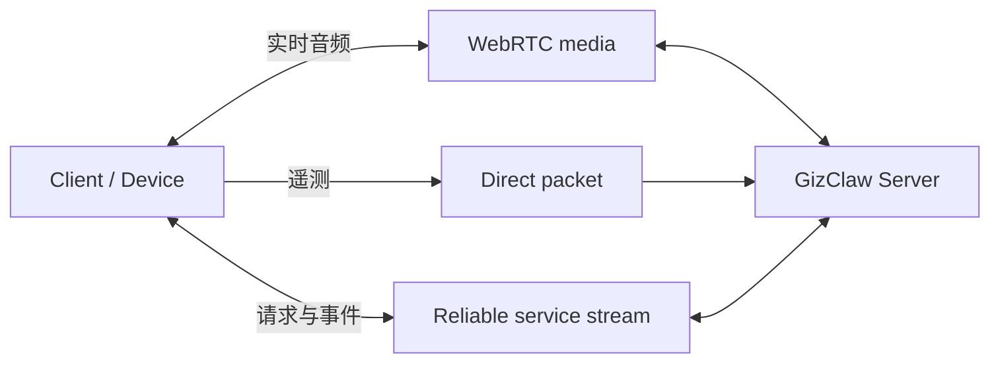

# Streams

GizClaw 在同一 Peer connection 上组合实时媒体、direct packet 与可靠 service stream。它们承担不同任务：媒体关注连续播放，packet 承载可丢弃的状态上报，service stream 承载请求、响应和事件。

## Transport overview

传输接口与 channel 语义见 [Giznet 源码](https://github.com/GizClaw/gizclaw/tree/main/pkgs/giznet)，产品 service 的注册与编号见 [Peer service](https://github.com/GizClaw/gizclaw/blob/main/pkgs/gizclaw/peer_service.go)。

## 一条连接有多少个 stream

connection owner 维护连接级媒体和 Event session；每次 RPC 或 HTTP 调用打开自己的 service stream。多个请求可以独立进行，关闭一次请求不等于关闭 Peer connection。

App 应通过 SDK 共享连接和事件订阅，避免为每个页面创建一套物理通道。可用容量、队列大小和失败处理由对应 transport 与 SDK 实现定义。

## Audio streams

实时 Opus 通过媒体轨传输，逻辑开始与结束通过 Event Stream 表达。RTP packet 不携带应用的逻辑流身份；使用 SDK 合并后的流接口接收音频，比 App 自行拼接两条通道更合适。

多个 source 由 Server 混音后交付；网络收包、逻辑输出结束与实际播放完成并非同一时刻。音频会话的使用说明见 [Events](./events#logical-stream-lifecycle)。

## Direct packets

Direct packet 用于低延迟状态上报，不适合需要业务确认的数据。Telemetry 的字段由 [peer_telemetry.proto](https://github.com/GizClaw/gizclaw/blob/main/api/proto/telemetry/peer_telemetry.proto) 定义，处理路径见 [Telemetry](/zh/developing/api/proto/telemetry)。

协议选择和接收逻辑见 [Peer connection](https://github.com/GizClaw/gizclaw/blob/main/pkgs/gizclaw/peer_conn.go) 与 [WebRTC packet transport](https://github.com/GizClaw/gizclaw/blob/main/pkgs/giznet/gizwebrtc/packet.go)。

## RPC streams

RPC 在可靠、有序的 service stream 上传输。Schema 定义请求与响应，codec 负责 framing，handler 负责调用领域服务。调用方使用 SDK，避免在业务代码中自行编码 envelope 或数字 method ID。

### Service stream IDs

service ID 选择协议入口，不标识某一次请求。具体分配由 [Peer service 源码](https://github.com/GizClaw/gizclaw/blob/main/pkgs/gizclaw/peer_service.go) 统一拥有；同一 service 的多次调用使用独立 channel。

### Gateway native channels

Edge 将客户端的逻辑连接转发到归属 Server，并为可靠调用、packet 与音频保留相应的数据通路。逻辑 session 的清理不应关闭同一 upstream 上的其他 session。

转发实现见 [Giztunnel](https://github.com/GizClaw/gizclaw/tree/main/pkgs/giznet/giztunnel)，产品组装与路由说明见 [Gizedge](/zh/developing/gizedge)。

### RPC frames

frame 的编码、类型和大小限制由 [RPC codec](https://github.com/GizClaw/gizclaw/blob/main/pkgs/gizclaw/api/rpcapi/codec.go) 定义。普通请求传输 envelope；需要二进制数据的调用在同一次请求中增加数据帧。

RPC 的结束标记只结束当前请求方向的数据序列，与 [Event 的逻辑结束](./events#four-different-end-boundaries) 不同。

### Binary streams

语音、图片、History 音频和 Lua 应用包可使用按请求传输的 binary stream。它们是有界数据传输，不是实时媒体轨。调用方按 SDK 返回的元信息消费数据，并在最终完成后再认定传输成功。

具体方法与消息从 [RPC Reference](./rpc) 进入对应 Schema；C 的 request 生命周期见 [gzc_rpc.h](https://github.com/GizClaw/gizclaw/blob/main/sdk/c/gizclaw/include/gzc_rpc.h)。

## Reliable ordered service stream writing

可靠 channel 的写入要遵守 transport 背压。调用方允许一次写入分多步推进，不能把 DataChannel message 边界当作上层 frame 边界。取消与关闭应结束自己拥有的请求，并释放缓冲和订阅。

共享字节预算见 [write_budget.go](https://github.com/GizClaw/gizclaw/blob/main/pkgs/giznet/write_budget.go)，WebRTC 写入实现见 [stream.go](https://github.com/GizClaw/gizclaw/blob/main/pkgs/giznet/gizwebrtc/stream.go)。
