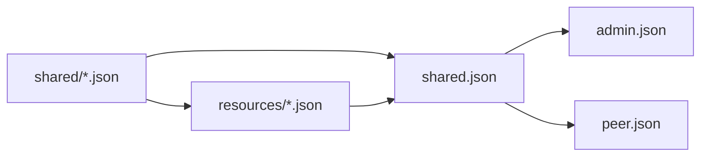

# HTTP Schema 依赖规则

仓库自有 HTTP schema 按所有权分为 Shared、Resources 和两个 API surfaces。OpenAI-compatible wire contract 属于 AI Server Shell，不进入本 graph。

## 目录

```text
api/http/
├── admin.json
├── peer.json
├── shared.json
├── shared/
│   └── ...
└── resources/
    └── ...
```

## 依赖方向



依赖必须保持单向：

```text
shared/ ← resources/ ← shared.json ← admin
shared.json ← public
```

`shared/` 不得引用 `resources/`。`resources/` 可以引用 `shared/`。`shared.json` 是生成入口，同时导出两层的稳定 schema；它的文件名不表示 Resource 属于 Shared ownership。

## Shared 规则

Schema 只有满足以下至少一个条件才能进入 `shared/`：

- 被两个以上 HTTP surfaces 直接使用；
- 被两个以上领域 owner 使用；
- 是多个 Resources 共用的稳定 value contract。

需要生成 Go 或 JavaScript symbol，不构成 Shared 的理由。只有一个 owner 的 schema 与 owner 放在同一文件。

### Shared 所有权

先在 [shared 源码目录](https://github.com/GizClaw/gizclaw/tree/main/api/http/shared) 查找实际 owner；只有不存在合适 owner 且确有多个独立 consumer 时，才新增 Shared 定义。领域专属类型放在对应 Resource 或 API surface 中，不以语言生成需求作为共享理由。

## Resource 规则

每个 `resources/<kind>.json` 同时拥有：

- Resource envelope 的具体 kind；
- 该 Resource 专属 Spec；
- 只服务于该 Resource 的 nested values；
- 对 Shared schema 的显式引用。

`resources/resource.json` 拥有 `ResourceAPIVersion`、`ResourceKind`、`ResourceMetadata`、Apply contract 与 Resource union。Resource 专属 Spec 不放入 `shared/`。

## Surface 规则

- `admin.json` 通过 `shared.json` 引用 Shared values 与 Resource graph。
- `peer.json` 只引用 `shared.json`，不引用 Admin Resources。Public-only DTO 直接定义在 `peer.json`。
- OpenAI-compatible wire models 留在 AI Server Shell，不引用仓库自有 Shared graph。

## 文件边界

文件边界按共同 owner 和共同变更确定：

- 单一 Resource 的 `*Spec` 内联到对应 Resource 文件。
- 一个领域中的 parent、enum 与 nested value 合并在同一个 Shared 文件。
- 只有存在独立复用和稳定语义时才拆出新 Shared 文件。

Schema 文件合并不得改变 JSON property、required/nullable 语义、enum value、discriminator 或 OpenAPI operation ID。
