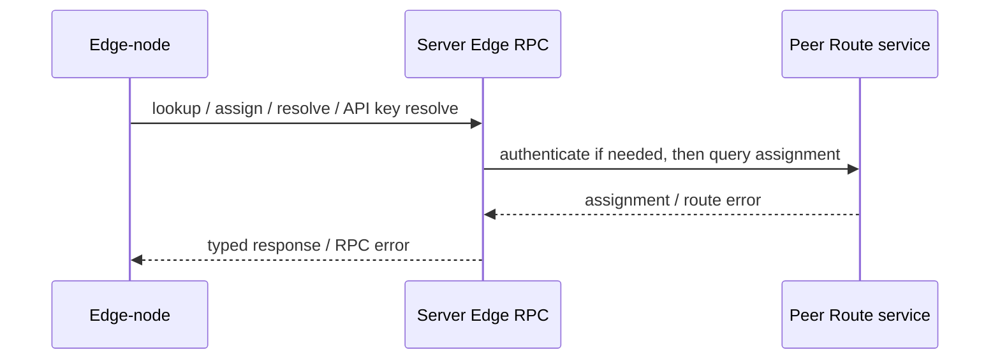

# Server Provided to Edge-node

这一组能力由 Server 实现，只提供给具有 Edge-node role 的连接。Edge-node 使用它查询 Peer assignment 和解析上游路由，不向普通 Client 暴露控制面能力。

准确的 method ID、名称与用途由 [RPC API Reference](/references/rpc#edge-rpc) 统一维护。本页只说明 Edge-node role、调用关系与授权边界。

## 调用关系

Server 使用独立 Edge RPC dispatch，接受 route methods 和终端通知投递。普通 Client RPC surface 即使共享同一 `rpc.proto` registry，也不能因为 method 可解码就获得调用权限；role authorization 与 service exposure 必须同时限制 Edge control plane。

`server.api_key.resolve` 允许 Edge 把收到的 Bearer credential 交给 Server 的 API Key service
认证，并取得 owner Peer 的固定 assignment。多 Server 部署让 Server 共享受保护的 API Key Redis
Store；Edge 不获得 Redis credential。RPC 只返回 assignment，不返回 API Key record、hash 或
secret index，并且不得在错误与日志中记录请求 credential。目标 Server仍会对原始 HTTP 请求
执行最终认证与授权。

## 通知投递与反向中继

`server.social.ping.deliver` 只向本地 Peer 推送 `client.social.ping`，成功要求设备 ACK；
目标不在本地时返回 NOT_FOUND，不继续中继。handler 对每次调用重新检查 active Edge role。

`edge.social.ping.relay` 的 provider 是 Edge，consumer 是其已验证身份的配置上游 Server。
Edge 按目标 PK 查询现有 Server assignment，在配置上游中选择归属 Server 并调用 deliver。
反向 handler 只注册在 Edge 主动建立的 Server transport 上，不注册在 device ingress。
两者共用源 proto 的 `SocialPingDeliveryRequest` 和 `SocialPingDeliveryResponse`，保留同一个
3 秒 deadline；具体路径与生命周期见 [Edge RPC](../../../gizclaw/rpc/edge#跨-server-通知)。
