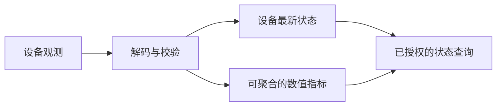

# Telemetry API

Telemetry 用于设备向 Server 单向上报观测，区别于 RPC 请求和 Admin 资源管理。消息字段、枚举与单位由 [peer_telemetry.proto](https://github.com/GizClaw/gizclaw/blob/main/api/proto/telemetry/peer_telemetry.proto) 定义；解码、状态投影与持久化见 [peertelemetry 源码](https://github.com/GizClaw/gizclaw/tree/main/pkgs/gizclaw/services/runtime/peertelemetry)。

传输语义见 [Direct packets](/references/streams#direct-packets)。

## 数据路径

观测消息、状态快照与指标分别服务于上报、当前状态展示和时间序列分析，调用方应选择对应入口，不把持久化模型直接当作 wire message。

## 设计规则

新增上报先修改 Schema，再同步生成 SDK 与实际收发方。数值指标应有明确单位；身份、版本和自由文本适合状态展示，不能随意变成高基数 metrics label。

设备时间用于判断观测的新旧，不等同于 Server 收到 packet 的时间。具体校验和合并规则查阅上述处理代码。

## Activity 上报

Activity 用来回答“设备现在在做什么”，作为状态供界面展示。应用可以本地化已认识的活动标识，但应保留未知值；不要从活动字符串推导权限或指标含义。

## 固件版本上报

版本用于展示发布身份，digest 用于识别具体包。查询方不应把版本显示或单次遥测视为安装验收，应结合设备确认的升级状态。

## Network 上报

网络观测区分当前路由的信号、连接状态和蜂窝身份。没有可读身份时不制造占位值，也不继续上报已移除 SIM 的缓存身份。

IMEI、IMSI 和 GNSS 是设备所属范围内的数据，只通过已授权状态查询展示，不写入日志、trace 或 metrics label。身份上报与设备标识索引的维护是不同路径，不能用其中一条隐式覆盖另一条。

## OTA 上报

一次升级尝试应保持同一个尝试标识，重新尝试使用新的标识。下载结束与安装成功是不同阶段，只有设备确认的最终状态才能用于展示成功。

状态查询读取 Server 保存的最新快照；设备离线后仍可能看到上次报告。遥测传输不提供业务确认或恰好一次交付，因此调用方不能将一次发送成功当作升级完成。

SDK 负责按 Schema 编码和发送，Server 负责校验与更新快照。状态转换与乱序处理见 [运行时 OTA 存储](https://github.com/GizClaw/gizclaw/blob/main/pkgs/gizclaw/services/runtime/peerrun/ota.go)。诊断信息由设备提供，不应包含 secret 或带凭据的 URL。
