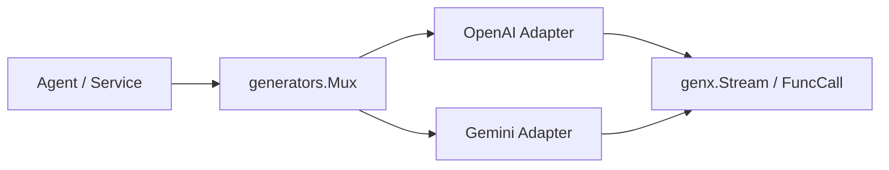

# Generators 总览

[源码](https://github.com/GizClaw/gizclaw/tree/main/pkgs/genx/generators)

`pkgs/genx/generators` 管理 `genx.Generator` 的注册与选择。调用方使用 pattern 选择 Generator，再以统一的 `ModelContext -> Stream` contract 执行生成，不直接绑定具体模型协议。

[Go API References](https://pkg.go.dev/github.com/GizClaw/gizclaw-go/pkgs/genx/generators)

## 结构

| 模块 | 职责 |
| --- | --- |
| [OpenAI Adapter](./openai) | 将 OpenAI-compatible Chat Completions 转换为 GenX message、stream、tool call 与 usage。 |
| [Gemini Adapter](./gemini) | 将 Gemini GenerateContent 转换为相同的 GenX contract。 |

Generators 只管理生成协议与路由。模型配置、credential、tenant 和产品 catalog 不属于这个 package。
