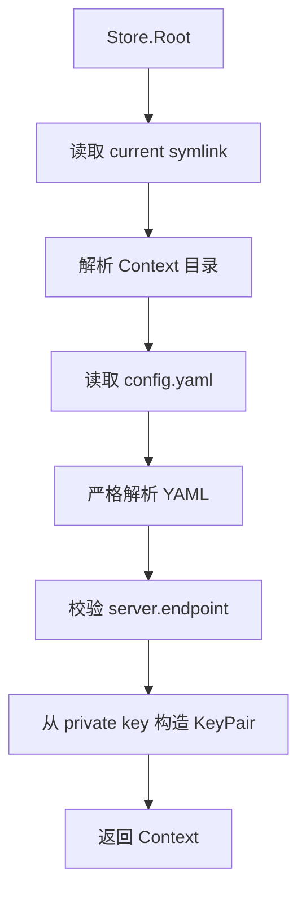

# Context Store

[源码](https://github.com/GizClaw/gizclaw/tree/main/pkgs/gizclaw/contextstore)

`pkgs/gizclaw/contextstore` 管理 GizClaw 客户端的本地连接 Context。每个 Context 绑定一个本地 Giznet identity 和一个目标 Server endpoint；CLI 或其他客户端先选择 Context，再使用其中的配置建立连接。

[Go API References](https://pkg.go.dev/github.com/GizClaw/gizclaw-go/pkgs/gizclaw/contextstore)

## 磁盘结构

```text
<context-root>/
├── current -> local
├── local/
│   └── config.yaml
└── staging/
    └── config.yaml
```

- 每个一级子目录是一个具名 Context。
- `current` 是指向当前 Context 目录名的符号链接。
- 新建 Context 目录权限为 `0700`，`config.yaml` 权限为 `0600`。
- 删除当前 Context 时会同时移除 `current`，不会自动选择替代 Context。

## config.yaml

```yaml
description: Local development server
identity:
  private-key: <giznet-private-key>
server:
  endpoint: 127.0.0.1:8080
```

`private-key` 是本地身份凭据，不能提交到仓库、文档示例或日志中。`Store.Create` 会生成新的 Giznet key pair，并只将 private key 写入 Context 配置。

## Config 结构

配置把本地身份和目标 Server 接入点放在同一个 Context 中。字段与校验由
[context.go](https://github.com/GizClaw/gizclaw/blob/main/pkgs/gizclaw/contextstore/context.go)
定义，具名 Context 的选择与磁盘操作见
[store.go](https://github.com/GizClaw/gizclaw/blob/main/pkgs/gizclaw/contextstore/store.go)。

## 加载流程



`LoadSummary` 走相同的配置与 private-key 校验，但只返回列表 UI 所需的名称、说明、endpoint、current 状态和本地 public key。

## Ownership 边界

Context Store 不负责 Server config、Peer registration、WebRTC signaling、HTTP/RPC client、workspace 内容或其他服务端资源。调用方从 Context Store 取得 identity 与 endpoint 后，再由连接层建立 GizClaw connection。
