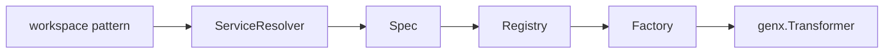

# Agent

[源码](https://github.com/GizClaw/gizclaw/tree/main/pkgs/gizclaw/services/runtime/agent)

[Go API Reference](https://pkg.go.dev/github.com/GizClaw/gizclaw-go/pkgs/gizclaw/services/runtime/agent)

`agent` 把 workspace pattern 解析成可运行的 workflow Transformer。它拥有 workflow factory registry 和从持久化 Workspace/Workflow 到运行规格的解析，但不拥有 Agent instance 的长期在线状态。

## 调用关系

`agent` 不负责 Peer connection、audio output、ToolKit 授权或 workspace lease；这些在线生命周期由 `agenthost` 组合。
