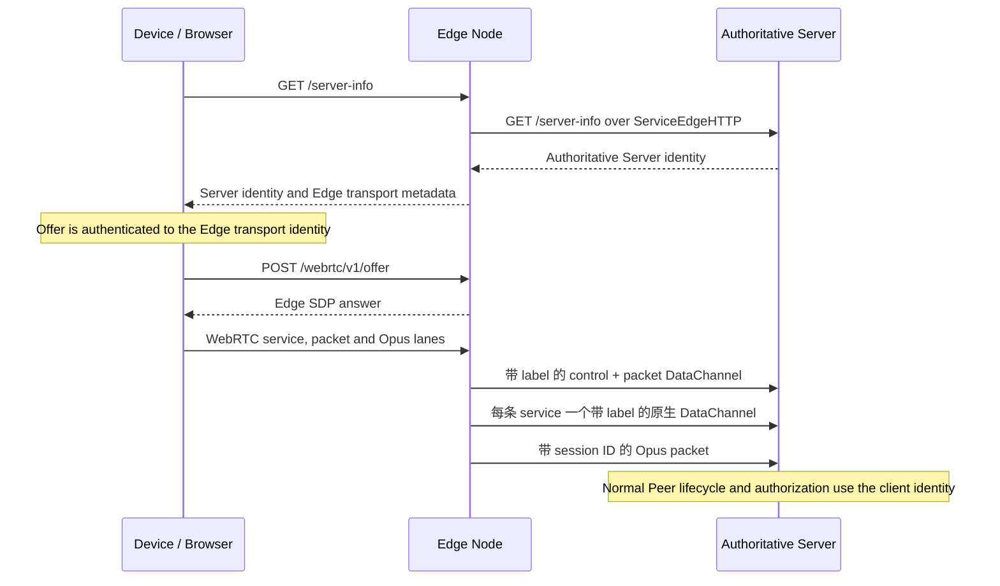
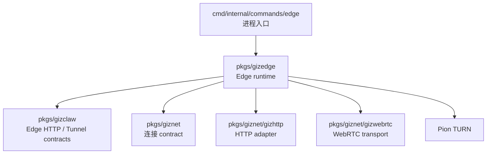

# pkgs/gizedge

`pkgs/gizedge` 提供 GizClaw 的 Edge Node ingress runtime。它在公网接收 browser 或 device 的 HTTP 请求，通过 `giznet` WebRTC connection 将请求转发到配置的 authoritative GizClaw Server。

启用 gateway 后，Edge 也是客户端 WebRTC transport 的终点，并把逻辑连接复用到有界的 Server upstream pool。Edge Node 仍不是业务数据的 owner；客户端 identity、最终授权、领域服务和资源存储均由上游 GizClaw Server 负责。

[Go API References](https://pkg.go.dev/github.com/GizClaw/gizclaw-go/pkgs/gizedge)

## 目录结构

```text
pkgs/gizedge/
├── config.go     # Edge workspace 配置与边界检查
├── edge.go       # Public ingress、上游连接和请求转发 runtime
├── gateway.go    # Client 终止、逻辑连接与有界 upstream pool
├── upstream_relay.go # 共享的 upstream TURN 选择与健康状态
└── turn.go       # 可选 TURN server runtime
```

`pkgs/gizedge` 当前是一个扁平 package。这里的代码共同构成单个 Edge Node runtime，还没有需要拆成独立公共子 package 的内部模块。

## Device 连接泳道

Edge Node 启动后已经通过 WebRTC 建立到 authoritative Server 的 giznet connection。Device 再通过 Edge 完成 Server discovery 和 WebRTC signaling：



这条链路中的 ownership 是：

- `/server-info.public_key` 始终是 authoritative Server identity；`transport.public_key`、`transport.endpoint` 和 `transport.signaling_path` 只选择本次 Edge WebRTC transport。客户端不能把 transport identity 当作业务 Server identity。
- Edge 校验 signaling 并创建客户端 PeerConnection。在已经认证的 Server PeerConnection 上，Edge 打开 canonical v2 control 与 packet label；control label 单独声明 logical client public key 和有界 remote address，不再发送 delegated body、expiry 或 replay proof。
- Server 只在 physical peer 已激活为 `edge-node` 后注册 v2 namespace，再以声明的 logical client public key 进入正常 Peer lifecycle、service policy 和领域授权。
- 每条可靠 client service 映射到一条带 label 的可靠有序 upstream DataChannel。Direct packet 使用每 session 独立的 unreliable channel；只有 Opus 保留 shared、session-tagged physical packet lane。
- Gateway transport 不把 authoritative Server 的 ICE/TURN server 列表返回给客户端，因此正常 gateway 路径不会为每个客户端创建 Server TURN allocation。

Edge 不在本地执行 GizClaw domain handler，也不建立第二套业务权限模型。

Gateway 仅对 `ServicePeerRPC` 启用发起方关闭即取消的 forwarding 规则。RPC request EOS
只是 framing，客户端仍保持 channel 等待 response EOS；客户端提前关闭该 channel 时，
Edge 立即关闭这条上游 RPC stream，让 authoritative Server 取消仍在进行的 SFU Join
等操作。Provider 先关闭时仍排空响应，其他 service 的排空规则、父 Peer connection 和
并行通话都不受单条 RPC 取消影响。

### Gateway lifecycle 日志

每次 logical-session attempt 都以 `gizclaw: peer stream lifecycle` 记录
`session_establishing`，随后记录有界的失败 `terminal`，或者依次记录
`session_accepted`、`bridge_started` 和 `terminal`。这些记录携带 gateway 生成的
`tunnel_session_id`、认证后的 logical `peer_public_key` 与有界的 upstream `entry_id`。
Terminal `result` 与 `reason` 区分完成、取消、超时、transport close 和 bridge error，
不记录 raw error。Edge 也不记录声明的 remote address 或 tunnel payload。

`bridge_started` 后的唯一 terminal record 还会投影有界 `BridgeObservation`：
`bridge_path`、`bridge_direction`、`bridge_phase` 与 `bridge_error_class`。
Destination-open failure 增加一个聚合 count 以及 first/last direction 和 class。精确的
established-session capacity rejection 还会增加
`bridge_capacity_scope=session|association`、`bridge_active_channels` 和
`bridge_channel_limit`；无法归属的 buffer-limit path 省略这三个字段。精确 capacity
优先映射为 `transport_error/channel_capacity_rejected`，其他 open rejection 映射为
`transport_error/bridge_error`；即使兼容 bridge error 为 nil，已观测到的 EOF 或 closed
terminal 仍映射为 `closed/transport_closed`。Clean、cancellation 和 deadline observation
分别保持 `success/completed`、`canceled/context_canceled` 与
`timeout/deadline_exceeded`。不会新增 per-stream lifecycle record。

Server 从 accepted `SessionDeclaration` 取得同一个 tunnel session identifier；该 identifier
是跨进程查询这条生命周期的正式关联键。

## 目录职责

### Edge 配置

Edge workspace 配置描述当前节点运行所需的基础信息：

- Edge Node 自身的 giznet identity。
- `webrtc` transport listen/endpoint、可选的公网 HTTP endpoint，以及一个或多个 HTTP/signaling listener。
- 至少一个有序 upstream Server entry；每个 entry 固定 endpoint、public key，以及可选的
  Edge-to-Server relay-only TURN pool。
- 可选的逐 listener TLS 证书文件。
- 可选 TURN listener、public endpoint、relay address、credential 和 relay port range。
- 可选 gateway 容量、upstream pool、buffer、idle 和 drain 边界。
- 可选 Prometheus Remote Write/query metrics backend。
- 可选把进程日志 fan-out 到 stderr 和由 Volc TLS 支撑的 LogStore。

`webrtc.listen` 是 WebRTC transport 的本地 bind tuple，同时必须等于
`http.listeners[0].listen`。Edge 在同一 host 和数字端口上打开独立的
TCP 与 UDP socket：第一个 TCP listener 承载 public HTTP 与 signaling，启用 gateway 时 UDP 承载 ICE、
DTLS、SCTP 与 DataChannel。`webrtc.endpoint` 是外部可达的 ICE UDP tuple，并通过顶层
`/server-info.endpoint` 发布；当 host 是具体 literal IP 时，gateway 还会把
answer SDP 的 UDP host candidate 改写为完全相同的 host 和 port。Hostname 或 unspecified
address 不触发 DNS lookup，也不会伪造 public candidate。额外的 HTTP listener 只增加 TCP
HTTP/HTTPS 入口，不发布 ICE candidate，也不创建 UDP socket。
`/server-info.transport.endpoint` 保留本次请求的协议以及 Host 中的域名和端口：
HTTP 请求返回 HTTP，TLS 请求返回 HTTPS；9821 与 443 入口各自返回原端口。
缺失或非法 Host（包括非法 DNS 名、IPv6、空端口或超出 1–65535 的端口）会在转发前返回 `400`；合法 Host 保留原拼写与显式端口。IPv6 必须使用方括号，且不接受 zone identifier。
不使用客户端提供的 `Forwarded` 或 `X-Forwarded-*` headers 改写入口。
可选的 `http.endpoint` 提供公网 access-point 的 path prefix，其协议、域名和端口
不覆盖请求入口；省略时不附加 prefix。该配置必须是绝对 `http` 或 `https` URL，
不能包含 userinfo、query、fragment、空 path segment 或无效 port；非法取值会在
listener 打开前失败。可选的
`turn.listen` 与 `turn.public-endpoint` 保持独立，因为它们配置的是 downstream relay
service，而不是客户端 HTTP/WebRTC 入口。

配置属于 Edge runtime，不复用 GizClaw Server 的 storage、service 或 domain 配置。Server config 也不应承担 Edge 进程的 public ingress 和 TURN 参数。Standalone Edge 的进程 metrics 使用独立的顶层配置：

```yaml
metrics:
  remote-write-url: https://prometheus.example.invalid/api/v1/write
  query-url: https://prometheus.example.invalid
  bearer-token: <prometheus-token>
```

三个字段都为空时 metrics recorder 保持 no-op；只要配置了任一字段，Remote Write URL 与 query URL 必须同时有效，否则 Edge 在打开 listener 前启动失败。Bearer token 只用于 backend 请求，不写入日志。

独立命令省略 `system-log` 时，Edge 进程日志保持 info-level stderr 默认值；嵌入式 Edge
在未配置该 block 时保留宿主已有的进程 logger。需要持久化同一批结构化
记录时，声明一个 Volc TLS physical storage、一个 logical LogStore，并让 sink
引用该 Store：

```yaml
storage:
  volc-logs:
    kind: volc-tls
    endpoint: ${GIZCLAW_VOLC_LOG_ENDPOINT}
    region: ${GIZCLAW_VOLC_LOG_REGION}
    access_key_id: ${GIZCLAW_VOLC_LOG_ACCESS_KEY_ID}
    access_key_secret: ${GIZCLAW_VOLC_LOG_ACCESS_KEY_SECRET}
stores:
  logs:
    kind: log
    storage: volc-logs
    topic_id: ${GIZCLAW_VOLC_LOG_TOPIC_ID}
system-log:
  level: info
  node_id: ${GIZCLAW_NODE_ID}
  sinks:
    - kind: stderr
    - kind: store
      store: logs
```

`node_id` 是 Deploy 分配的稳定逻辑节点名，例如 `e2e-edge-volc-bj-01`；它会进入该
进程的每条 stderr 和持久化日志。GizClaw 不用写入端 IP、hostname、endpoint 或 Edge
public key 猜测该值。省略时保持本地与嵌入式 runtime 的兼容行为，但持久化部署应显式配置。

Edge 只接受 `volc-tls` physical storage 和 `log` logical Store。在打开 listener
或连接 upstream 之前，Edge 会验证配置、Store 引用、credential、topic index 和 logger
sink。Edge runtime 停止后再恢复此前的进程 logger，并关闭 logical 和 physical logging
资源。Edge 不支持 `system-log.query_store`，也不暴露 Server Admin 日志查询 API；operator
通过 observability backend 直接查询共用的 Volc TLS topic。

同一个 Go 进程内只允许一个配置化 Server 或 Edge runtime 持有进程级 logger。第二个配置化
runtime 会在打开 listener 前失败，不能替换第一个 runtime 的 logger，也不能在退出时恢复
过期 logger。owner 停止并恢复宿主 logger 后，另一个配置化 runtime 才能启动。

HTTP listener 按声明顺序启动，每个 listener 可省略 `tls` 提供明文 HTTP，或同时配置本地
`cert-file` 与 `key-file` 提供 TLS 1.2 及以上的 HTTPS。地址必须唯一，证书对会在打开流量前加载；
空列表、单边证书配置、无效证书或重复地址会使启动失败。`http.listeners` 必填，并且第一个地址
必须等于 `webrtc.listen`。证书只能配置在各 listener 内。证书路径支持环境变量。

```yaml
webrtc:
  listen: 0.0.0.0:9821
  endpoint: 192.0.2.10:9821
http:
  endpoint: https://ap.gizclaw.com
  listeners:
    - listen: 0.0.0.0:9821
    - listen: 0.0.0.0:443
      tls:
        cert-file: ${GIZCLAW_TLS_CERT_FILE}
        key-file: ${GIZCLAW_TLS_KEY_FILE}
```

### Public Ingress

Public ingress 负责：

- 监听 Edge Node 的 public HTTP endpoint。
- 将允许的 browser/device API 请求转发给 authoritative Server。
- 为浏览器请求提供 ingress 所需的 CORS 行为。
- CORS 使用请求中的实际 `Origin` 并返回 `Vary: Origin`；受支持路径的 `OPTIONS` 预检在 Edge 终止，不占用 upstream，方法与 headers contract 和 authoritative Public HTTP 保持一致。 Edge 允许 `GET,POST,PUT,DELETE,OPTIONS`，包含已有 Device volume/playlist PUT；实际请求保留 method、path、body 并继续接受 authoritative Server 的认证与授权，预检成功不授予业务权限。
- 在 server-info response 中分别发布 Edge HTTP access point 与 ICE UDP endpoint。
- 在进程停止时关闭 HTTP server、上游 connection 和相关 listener。

Edge ingress 不拥有 Peer HTTP、OpenAI-compatible HTTP 或其他 product route 的业务实现。具体 route 由 `pkgs/gizclaw` Server 提供，Edge 只转发公开 surface。

`/gizclaw/v1/*` 与 `/openai/v1/*` 是 API Key 路由路径。Edge 从 Bearer header 取得 credential，
通过已经认证并加密的 `ServiceEdgeRPC` 请求任一可达 Server 认证 API Key、取得 owner Peer，
再解析该 Peer 的固定 Server assignment。Edge 只向 `server_public_key` 精确匹配的已配置 upstream
转发原始请求，目标 Server 仍会重新认证 API Key 并执行领域授权。Edge 不连接 API Key Redis，
也不缓存或记录 credential。多 Server 部署应让各 Server 的 `services.api_key.store` 绑定同一个
受保护的 Redis KV scope。

无效或撤销的 key 返回 `401 INVALID_API_KEY`；owner assignment 缺失或 inactive 返回
`403 API_KEY_OWNER_UNAVAILABLE`；目标 Server 未配置或不可达返回
`503 API_KEY_SERVER_UNAVAILABLE`。这些路径都不会回退到错误的 Server，也不会把 credential
写入错误响应。

### Upstream Connection

Edge Node 使用 `pkgs/giznet/gizwebrtc` 连接配置的 authoritative Server。`ServiceEdgeHTTP` 承载 public HTTP forwarding；gateway logical sessions 使用注册的 `giznet/v2/tunnel/` DataChannel namespace，不占用 product service ID。

默认省略每个 entry 的 `ice-transport-policy` 和 `ice-servers`，保持
direct ICE。启用 relay 时配置至少两个 literal-IP TURN/UDP 成员：

```yaml
upstreams:
  - endpoint: https://server.example.invalid:9820
    public-key: <authoritative-server-key>
    ice-transport-policy: relay
    ice-servers:
      - urls: [turn:192.0.2.10:3478?transport=udp]
        username: <turn-rest-key-id>
        credential: <turn-rest-shared-secret>
        credential-mode: turn-rest
      - urls: [turn:192.0.2.11:3478?transport=udp]
        username: <turn-rest-key-id>
        credential: <turn-rest-shared-secret>
        credential-mode: turn-rest
```

relay mode 为每条新 upstream PeerConnection 只传入一个 pool member 和
relay-only ICE。HTTP forwarding 与 gateway upstream 共享同一个进程内
round-robin 健康 selector。relay 失败后进入有上限的指数退避；连接仍在原有 30 秒预算内
尝试其他 eligible member，每个 member 最多使用 5 秒，并且绝不回退到 direct ICE。
建立必需的 gateway warm pool 时，Edge 还会遵守 selector 返回的 backoff，并在共享的
30 秒启动预算内重试暂时不可用的 member。如果 5 秒 warmup 只建立了部分 pool，Edge 会
保留已经成功的 association，并在同一预算内只补齐缺少的 slot；配置、取消和其他错误仍
立即失败。成功重连会清除该 member 的失败状态；request cancellation、Edge shutdown 或
单个 logical session 失败不会惩罚 relay。已有 gateway session 保持绑定到原 physical
upstream，可能随其失败；新的 client reconnect 才会从当前 healthy pool 重新选择。

每个 pool member 只允许一个小写 `turn:` URL，地址必须是 literal IPv4 或带方括号的
IPv6、显式端口，并且 query 只能是 `transport=udp`。static mode（显式或默认）同时要求
`username` 和 `credential`；`turn-rest` 要求作为 shared secret 的 `credential`，配置的
username/key ID 可为空。无效、重复、字段不完整、hostname、TCP 或 TLS relay 配置都会在
Edge 启动 listener 前失败。

relay 选择不会改变 entry 的 `endpoint`、`public-key` 或 signaling 使用的
Server identity。顶层 `turn` block 与它相互独立：该 block 运行 device-to-Edge 的
downstream TURN server，不是 Edge-to-Server upstream pool member。日志不得记录 relay
username、credential、SDP、ICE candidate body 或业务 payload。

每条 gateway upstream 是一条独立的 WebRTC PeerConnection 和 SCTP
association；每个 logical session 在选中的 upstream 上拥有 persistent control、packet，
以及每条 live service 独立的原生 DataChannel。多个 DataChannel 仍共享 association 级的拥塞控制和
调度。pool 启动时建立 4 条 upstream（不超过 `max-upstreams`），之后按 least-active
分配 session；只有所有 healthy association 都达到配置的 active-session 容量后才扩展
下一条 upstream。这个有界 warm pool 同时避免单 association 的队头阻塞，以及一次铺满
16 条冷 SCTP association 的启动与拥塞收敛成本。

默认每条 upstream 最多保持 2048 个 active logical sessions、每 session 32 条 active
channel，以及 8192 条同时 active 的 tunnel channel。关闭 channel 会释放容量，连续打开
并关闭不会触发 upstream rotation。Edge 无法建立有界 warm pool 时启动失败；后续只有确实需要新增
association 的 admission 会受扩容失败影响。单条 upstream 失败只关闭固定在该连接上的
会话，其他 upstream 和其他 Edge 不受影响。

pool eligibility 有三个状态。selectable association 可以接收新 admission；draining
association 不再接收新 admission，保留已经建立的 logical session，并在最后一个 pinned
session 释放后关闭；failed association 是 terminal 状态并立即关闭。仍为 nonterminal 的
association 如果发生 native control/packet open error、pre-accept channel close，或者完整的
application-acceptance timeout，会进入 draining，但不会惩罚其 TURN member。caller
cancellation、Edge shutdown、显式 logical-session rejection 和其他 nonterminal protocol
error 不会改变 healthy association 的 eligibility。packet 或父连接失败会进入 failed，并且
对应 relay attempt 最多报告一次失败。

fresh client 共享一个私有的三十秒 logical-session establishment budget，并且只允许在
Server acceptance 前尝试至多两条 physical entry。alternate 会重新创建 control/packet
pair 和 session ID，不重放 RPC，也不迁移已经
accepted 的 session。warm capacity 只计算 selectable association，`max-upstreams` 继续限制
selectable 与 draining 在内的全部 live physical association。由于 signaling response 在可能
选择 alternate 之前已经写出，`X-GizClaw-Gateway-Upstream` 仍表示最初预留的 entry。

HTTP forwarding 和 gateway upstream 都属于长生命周期 runtime 状态。Edge package 不应通过自行复制 GizClaw handler 来规避上游不可用。

### Gateway 容量与生命周期

Gateway 的默认总容量为 30,000 sessions，最多 16 条 upstream。信令进入时先同时预留 handshake、总 session 和 active-channel 容量；没有容量时返回稳定的 `503` JSON error `gateway_over_capacity` 和 `Retry-After: 1`，不会先在 Server 创建半连接。

每个 session 默认有 1 MiB reliable-write budget，单 channel 最多占一半，为 sibling
Event/RPC 保留进度；association budget 是 32 MiB。reservation 要等 DataChannel
`BufferedAmount` 排空后释放，不会因为暂时背压而截断 firmware 等大文件。
5 分钟无 activity 的 session 默认被回收。进程关闭时先停止新 admission，在 30 秒 drain
deadline 内保留现有 session，超时后强制关闭。

容量档位、relay recovery、burst、soak 与吞吐 benchmark 的入口、门槛和 artifact 说明统一见
[Gateway 容量与中继验收](testing#gateway-capacity)。配置容量上限不代表部署性能保证。

### TURN

Edge Node 可以同时运行可选的 TURN UDP relay，为无法直接建立 WebRTC 路径的连接提供 relay 能力。

TURN runtime 只负责 relay listener、认证和 relay port range。它不负责 GizClaw 用户登录、Peer resource access、route assignment 或业务授权。TURN credential 与 GizClaw resource credential 也不是同一类数据。

### Upstream relay 验收

Edge 的 control association 与有界 gateway upstream pool 可以直接连接 authoritative
Server，也可以通过 `ice-transport-policy: relay` 强制走配置的 Coturn pool。Relay 模式每次
Dial 只选择一个 pool member，不能回退到 direct candidate。这是 Edge-to-Server 产品拓扑，
只测 Giznet transport 的 Coturn suite 不会覆盖它。

成功持有 upstream 后，Edge 会为 control epoch 和每个 live gateway entry 各输出一条脱敏的
selected-ICE observation，供 Testing Guide 中的 gateway capacity 验收使用。它是诊断证据，
不是 public API，也不构成 production performance 保证。

测试拓扑与 path、allocation、traffic 和 cleanup 检查见
[Edge direct 与 Coturn capacity 对照](testing#gateway-relay-capacity)。

## 依赖关系



依赖方向是：

- CLI command 选择 workspace 并启动 `pkgs/gizedge`。
- `pkgs/gizedge` 消费 GizClaw 定义的 Edge service contract，但不依赖具体领域 service。
- Edge 使用 `giznet`、`gizhttp` 和 `gizwebrtc` 建立上游数据路径。
- `pkgs/gizclaw` 和 `pkgs/giznet` 不依赖 `pkgs/gizedge`。

## Ownership 边界

应该放在 `pkgs/gizedge`：

- Edge workspace 配置和 Edge-specific validation。
- Public ingress listener、proxy 和 Edge response rewrite。
- Edge 到 authoritative Server 的连接、登录、重连和转发生命周期。
- Client WebRTC termination、logical session admission、upstream pool 和 gateway shutdown。
- Edge Node 自己运行的 TURN relay。
- 只属于 Edge process 的 shutdown 和 cleanup 行为。

不应该放在 `pkgs/gizedge`：

- Peer、workspace、firmware、social 或 Agent 领域服务。
- Authoritative resource storage 和最终 resource access 判断。
- Transport-independent connection contract 或通用 WebRTC 实现。
- GizClaw Server 的 HTTP/RPC handler。
- Server storage backend、migration 和 workspace runtime 组装。
- 全局 peer directory、mesh membership、跨 Server 数据同步或 route replication。

相关业务、传输与进程组装分别由 `pkgs/gizclaw`、`pkgs/giznet` 和 `cmd/internal/server` 拥有。

## 当前边界

`pkgs/gizedge` 只读取非空、有序的复数 `upstreams`。每个 entry 都固定一套完整的 Server endpoint、public key、ICE policy 与 relay pool。缺少有效的 `upstreams`、空列表、重复 identity/endpoint 或不完整 entry 都会在 listener 打开前失败。

公开 Go 配置 API 同样以复数列表为准：`Config.Upstreams` 是唯一的 Server 配置字段，`Config.BootstrapUpstreamURL()` 返回有序列表第一项的 URL。选中具体 Server 后的 URL 只属于 Edge 内部 target 状态。

对于 authenticated logical Client session，Edge 会通过任意可达的已配置 Server 查询共享的固定 Peer assignment，确认返回的 Server identity 已在配置中，然后只获取该 Server 的 target pool。Assignment 不存在时，首次 claim 使用顺序中第一台可达 Server。Control、service、packet、audio、retry 与 teardown 始终固定在同一个 target；target transport 失败不能替换成其他 Server owner，也不能重放 application work。仅配置一个 entry 时仍走同一套路由和 Server admission 逻辑。

Public `/server-info` 以及只有 API key、未建立 logical Peer session 的 HTTP/OpenAI request 继续通过顺序中第一台可达 bootstrap Server。Assignment 中的 endpoint metadata 不能覆盖 Edge 固定配置；relay selector、health 与 backoff 按 Server entry 隔离。

Edge 使用显式 Server 列表，不维护动态 mesh membership 或全局路由，也不复制 Server 数据。
跨 Server 语音由 GizClaw Server 的共享 Social KV 与 SFU Room 处理，见 [Social](gizclaw/services/social#sfu-workspace)。

## Server 握手准入边界

Server 的 `peer-admission: registration-token` 只检查到该 Server 的 WebRTC handshake。
配置在 `edge-nodes` 中且未 blocked/删除的 Edge 公钥已在启动时建立记录，上游 Dial
无需 credential。Edge 自己终止客户端 signaling，使用 Giznet 的兼容封装解析器；其
当前 gateway policy 不解释 credential，也不把它传入 logical tunnel。Server 端的
此开关不会对这些 logical clients 重新执行握手准入，不能把它当作整个 Edge ingress
的注册要求。产品注册与资源权限仍由 authoritative Server 处理。

## 跨 Server 社交通知

Edge 为配置上游 Server 提供反向通知 RPC，使用现有 Peer assignment 查询和多 Server
上游连接，把通知送到目标归属 Server；中继无需承载目标设备的 ingress connection。
通知只允许受支持的 social ping，设备 ACK 前不会成功，不广播、不排队、不重试。
目标上游必须已配置且可达；不从响应 endpoint 动态信任新 Server。
协议、权限和取消边界见 [Edge RPC](./gizclaw/rpc/edge#跨-server-通知)。

### 基础设施聚合帧读取

`/gizclaw/v1/infra/flows` 是公开只读的精确路径，经配置的 upstream 读取共享 KV 基础设施聚合帧，无需 token，也不查询设备 API-key 或 owner。Server 与 Edge 均保留跨域 GET/OPTIONS、405 和 no-store；相邻路径继续走既有授权规则。读取上限、配置与部署验收见 [Infrastructure Flow Feed](infra-flow)。
